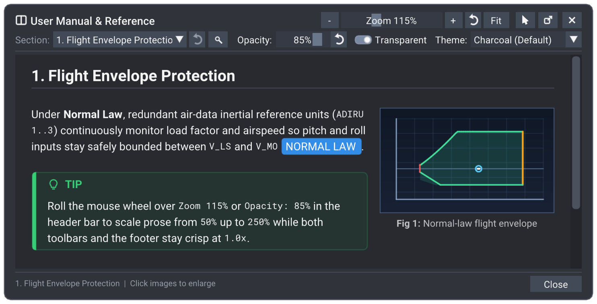
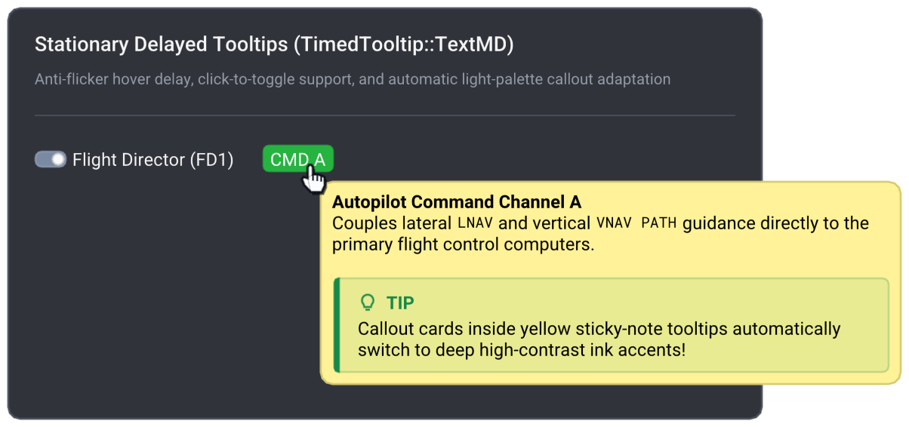
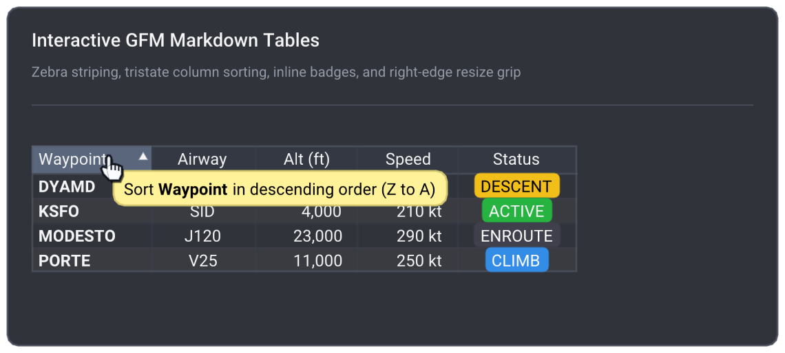
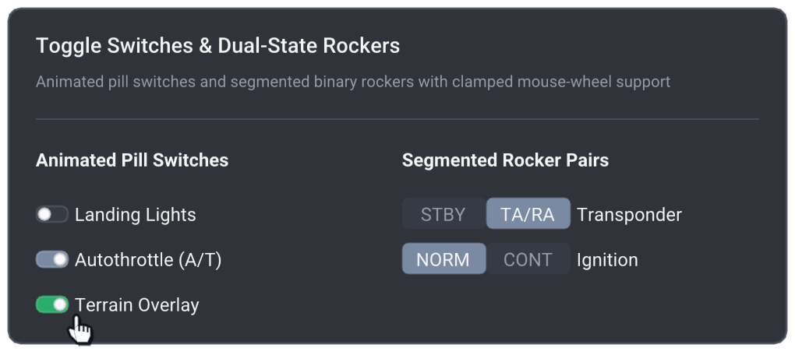
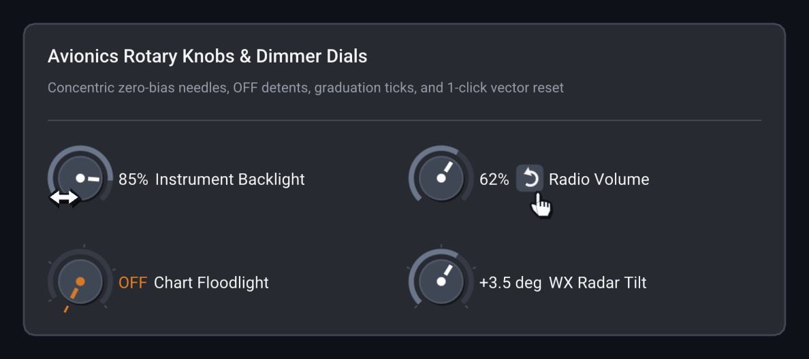
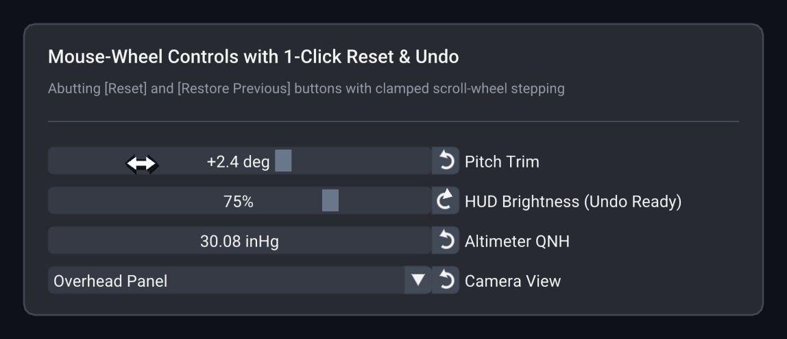

# ImGee: Modern Ergonomic UI Toolkit for Dear ImGui
**Architecture & Developer Reference**

**ImGee** turns stock [Dear ImGui](https://github.com/ocornut/imgui) from a game-debugger overlay into a tactile, ergonomic immediate-mode UI system for desktop applications, studio and audio/CAD tools, game engines, developer utilities, and simulators in **a single header `#include`** -- with zero `.cpp` files to compile and zero CMake changes.

Where vanilla Dear ImGui flashes cursor-chasing plain-text tooltips, ignores the mouse scroll-wheel, leaves interactive buttons on a dead `Arrow` cursor, and renders missing-glyph `?` boxes for Unicode symbols, **ImGee** gives you polite stationary `TimedTooltip`s, mouse-wheel sliders/combos/pulldowns with 1-click Reset-with-Undo (`↺`/`↻`), 270° rotary dimmer knobs, animated toggle switches, CommonMark + sortable GFM tables, text-wrapping image floats with interactive zoom/pan lightboxes, a turnkey `DocumentViewer`, semantic typography (`ImFontRole` & `StyledText`), curated color themes (`Charcoal`, `Rusty`, `Paper Light`), and a zero-font procedural vector icon engine.



> **Standalone Dear ImGui Toolkit + Turnkey `ImgWindow` Integration:**  
> **ImGee** ([`slgoldberg/ImGee`](https://github.com/slgoldberg/ImGee)) is a standalone, 100% generic Dear ImGui C++ toolkit (`v1.84` through `v1.92+`) with zero dependency on any specific windowing backend or host engine. Born and battle-tested in high-workload studio and flight-simulation environments, it also mounts directly at `ImgWindow/contrib/ImGee/` (with convenience forwarder `contrib/imgee.h`) for X-Plane plugin authors using [`ImgWindow`](https://github.com/slgoldberg/ImgWindow), auto-wiring texture uploading, in-memory image decoding, and reload cleanup when `ImgWindow.h` is present.

---

## 📖 Documentation & Guides

* **[Comprehensive ImGee User Manual (Markdown)](docs/ImGee_User_Guide.md)** • **[(PDF Manual)](docs/ImGee_User_Guide.pdf)**: Full API reference, copy-pasteable C++ examples, typography tables, and architectural details.
* **[The ImGee UX Design Manifesto (Markdown)](docs/ImGee_UX_Design_Manifesto.md)** • **[(PDF Standard)](docs/ImGee_UX_Design_Manifesto.pdf)**: Human-factors principles, cursor & wheel affordance laws, "Lens UI" focus latching, and developer checklists.
* **Component Reference Guides:** [Extensions Suite](extensions/README.md) • [Immediate-Mode UI Widgets](widgets/README.md) • [Curated Color Themes](themes/README.md)

---

## 🏛️ Architecture: The Two Categories of Content

Every component within ImGee is delivered strictly as a **single, self-contained C++ header file (`.h` only)**. There are zero `.cpp` compilation units to add to your build system, zero static or dynamic link dependencies, and zero order-of-inclusion restrictions. You can `#include` ImGee headers in any order without circular dependency hazards.

ImGee is divided into two complementary architectural categories plus curated color palettes:

```
ImGee/
├── extensions/          # Stateful subsystems (TimedTooltip, Markdown, Typography, Viewport, DocViewer)
├── widgets/             # Immediate-mode UI controls + procedural vector icons (.h only)
└── themes/              # Curated color palettes (Charcoal, Rusty, Paper Light)
```

### 1. Flagship Extensions (`extensions/`)



Extensions are self-contained subsystems that address deep architectural gaps in stock Dear ImGui -- maintaining frame-to-frame timing, parsing CommonMark/GFM syntax, managing semantic font hierarchies, or isolating content zoom:

* **[`TimedTooltip`](extensions/TimedTooltip/README.md) (`imgui_tooltip_ext.h`):** Replaces cursor-following `ImGui::SetTooltip()` with stationary, dwell-timed sticky-note tooltips featuring screen-edge clamping, cursor preservation, click-to-toggle support, and wheel-scroll dismissal.
* **[`Markdown`](extensions/Markdown/README.md) (`imgui_markdown_ext.h`):** Interactive CommonMark + GFM tables with tristate column sorting and drag-resizing, GFM alert callouts (`> [!NOTE]` .. `[!CAUTION]`), 3-tier images with text-wrapping floats and interactive zoom/pan lightboxes, inline tags (`<badge>`, `<pill>`, `<kbd>`, `<icon>`), and `ButtonMD`.
* **[`Typography`](extensions/Typography/README.md) (`imgui_font_roles.h` & `imgui_styled_text.h`):** A 9-slot semantic font registry (`ImFontRole`), RAII `ScopedFontRole` guards, and baseline-aligned `StyledText` for inline rich readouts without full Markdown block margins.
* **[`Viewport`](extensions/Viewport/README.md) (`imgui_zoomable_viewport.h`):** Two-layer `BeginZoomedViewport` / `EndZoomedViewport` container keeping window chrome at crisp `1.0x` while zooming scrollable inner content smoothly from `50%` to `250%`.
* **[`DocViewer`](extensions/DocViewer/README.md) (`imgui_doc_viewer.h`):** Turnkey standalone `ImGui::DocumentViewer` with automatic ATX Table-of-Contents section jumping, 1-click scroll-to-top / return-to-spot (`↺`/`↻`), in-document live Find (`Ctrl+F` / `Cmd+F`), `#heading-slug` anchor navigation, zero-shift opacity controls, and 5-preset theme switching.

<br clear="all"/>



> [!IMPORTANT]
> **The Flagship Core:** `TimedTooltip`, `Markdown`, and `Typography` form the foundational triad of ImGee, while `Viewport` and `DocViewer` build directly on top of them to deliver turnkey in-app manuals and reference guides.

### 2. Immediate-Mode UI Widgets (`widgets/`) & Themes (`themes/`)



Widgets are lightweight, zero-dependency immediate-mode controls. They hook directly into Dear ImGui's ambient context (`GImGui`, ID stack, `ImGuiStorage`, and active window draw lists) and live in the root `ImGui::` namespace so they feel completely native alongside built-in controls.

* **Completely Independent:** Even if a project disables every extension (`#define IMGEE_DISABLE_EXTENSIONS`), all widgets in [`widgets/`](widgets/README.md) remain 100% usable and self-sufficient.
* **Built-In Human Factors:** Active cursor affordances (`Hand`, `ResizeEW`, `ResizeNS`), automatic scroll pass-through on scrollable parent panels, 1-click Reset-with-Undo (`↺`/`↻`) session memory, and zero-font procedural vector icons come wired in automatically.

<br clear="all"/>





---

## 📐 Common Design Standards & Namespacing

ImGee follows established conventions from the wider Dear ImGui ecosystem:

### 1. Omar Cornut's Ecosystem Standard (Single Point of Discovery)
In official Dear ImGui extensions and ecosystem projects (such as `implot`, `imgui_club`, and `imnodes`), Omar Cornut advocates extending `namespace ImGui { ... }`:
* **Discoverability & Autocomplete:** Typing `ImGui::` surfaces every widget and subsystem in one place via IDE autocomplete.
* **Zero Cognitive Overhead:** No artificial root namespaces or scattered `using namespace` declarations to juggle.

### 2. Second-Level Sub-Namespaces for Subsystems
Heavyweight subsystems encapsulate their APIs cleanly inside second-level sub-namespaces under `ImGui`:
* `ImGui::TimedTooltip::`
* `ImGui::Markdown::` (with official shorthand alias `ImGui::MD::`)

*(Lightweight typography helpers such as `ImGui::ImFontRole`, `ImGui::SetFontRole`, `ImGui::ScopedFontRole`, and `ImGui::StyledText` live directly in `ImGui::` alongside standard text APIs.)*

```cpp
ImGui::TimedTooltip::Text("Hover-delayed stationary tooltip.");
ImGui::MD::TextWrapped("Configure your **workspace preferences** below.");
```

### 3. Convenient Root Shorthands & Global Scope
* Shorthands such as `ImGui::TextMD(...)`, `ImGui::ButtonMD(...)`, `ImGui::BeginZoomedViewport(...)`, and `ImGui::DocumentViewer(...)` are exposed directly in `ImGui::`.
* Defining `#define IMGEE_ENABLE_GLOBAL_NAMESPACES` publishes `Markdown::`, `MD::`, and `TimedTooltip::` to the global scope when maximum brevity is preferred.

---

## 🌐 Generic Dear ImGui Core & Multi-Language Bindings

**ImGee core is 100% generic Dear ImGui.** Nothing in the C++ toolkit requires any simulator or platform-specific framework -- any desktop application, audio/video studio tool, CAD utility, game engine, or simulation host using Dear ImGui can drop ImGee right in.

### 1. LuiGee: Lua Bindings for FlyWithLua
For Lua developers in the X-Plane ecosystem, ImGee's UI capabilities are available inside FlyWithLua as **LuiGee**, bringing animated switches, rotary knobs, vector icons, and timed tooltips to X-Plane 11.20+ and X-Plane 12+ scripts with idiomatic Lua syntax.

### 2. Community & Other Language Bindings
We are open to bindings for additional environments and languages (such as **Python**, **Rust**, and **C#**). Developers interested in bringing ImGee to other platforms or language ecosystems are warmly invited to collaborate.

---

## 🚀 Quick Start & Integration Models

### 1. Standalone Clone or Git Submodule (Recommended)
Add **ImGee** to your project (e.g. `git submodule add https://github.com/slgoldberg/ImGee.git third-party/ImGee`), add its directory to your include path, and include `imgee.h`:

```cpp
// When ImGee/ itself is on your -I include path:
#include "imgee.h"

// Or when the parent directory of ImGee/ is on your -I include path:
#include "ImGee/imgee.h"
```

### 2. A-La-Carte & Order-Independent Inclusion
Subsystems and individual widget headers can also be cherry-picked in any include order:

```cpp
#include "ImGee/extensions.h"              // Only extensions (TimedTooltip, Markdown, Typography, Viewport, DocViewer)
#include "ImGee/widgets.h"                 // Only immediate-mode widgets & vector icons
#include "ImGee/widgets/imgui_knobs.h"     // Or individual control headers
```

### 3. Optional GPU Texture Backend for Standalone Apps (`ImGee::HostBackend`)
All vector widgets, icons, themes, typography, tooltips, and Markdown text/tables work with zero setup. If your standalone Dear ImGui app (GLFW, SDL, Win32, Metal, Vulkan, DX11/DX12) also renders **local disk or async HTTP/HTTPS Markdown images**, register two texture callbacks at startup and call `ImGee::Shutdown()` before tearing down your graphics device:

```cpp
ImGee::HostBackend backend;
backend.CreateTextureRGBA8 = [](const unsigned char* rgba, int w, int h, void*) -> ImTextureID {
    return MyRenderer_UploadRGBA8Texture(rgba, w, h);
};
backend.DeleteTexture = [](ImTextureID tex, void*) {
    MyRenderer_DestroyTexture(tex);
};
ImGee::SetHostBackend(backend);

// On application exit (before destroying your GPU device):
ImGee::Shutdown();
```

### 4. Turnkey X-Plane Integration via `ImgWindow`
When consumed via an `ImgWindow` submodule in an X-Plane plugin, include `"ImgWindow/contrib/imgee.h"` (or `"contrib/imgee.h"` when `ImgWindow/` is on `-I`). When `ImgWindow.h` is detected on the include path, ImGee bridges named textures, `ImGeeStbi` memory-image decoding, and plugin-reload VRAM cleanup automatically.

---

## 🧩 Subsystems & Module Structure

```
ImGee/
├── imgee.h                           # Canonical ImGee Master Header & Version Contract
├── imgee_host_backend.h              # Standalone GPU texture, path & shutdown hook contract
├── includes.h                        # Folder-level Roll-Up Header (-> imgee.h)
├── extensions.h                      # Subsystem Roll-Up Header (-> extensions/includes.h)
├── widgets.h                         # Subsystem Roll-Up Header (-> widgets/includes.h)
├── imgee-global.h                    # Opt-in Global Scope Aliases (Markdown::, TimedTooltip::)
├── imgee_stbi_internal.h             # Isolated namespace/symbol-prefixed PNG/JPG/GIF/BMP/TGA decoder
├── imgee_stb_image.cpp               # Optional single-TU build unit (for -DIMGEE_EXTERNAL_STB_IMAGE)
├── stb_image.h                       # Vendored stb_image implementation wrapped inside ImGeeStbi
├── LICENSE                           # Open-Source License (BSD 3-Clause)
├── docs/
│   ├── ImGee_User_Guide.md           # Comprehensive User Manual (Source)
│   ├── ImGee_User_Guide.pdf          # Compiled Publication-Grade Manual
│   ├── ImGee_UX_Design_Manifesto.md  # Human Factors & Ergonomics Standard (Source)
│   ├── ImGee_UX_Design_Manifesto.pdf # Compiled UX Design Manifesto
│   └── images/                       # 2x Retina widget & extension showcase figures
├── extensions/                       # Stateful Subsystems
│   ├── README.md                     # Extensions Architecture & Sub-Namespace Guide
│   ├── includes.h                    # Extensions Roll-Up Header
│   ├── TimedTooltip/                 # Stationary & delayed tooltip engine with edge clamping
│   ├── Markdown/                     # CommonMark, GFM tables/callouts, floats, lightboxes & tags
│   ├── Typography/                   # Font roles (ImFontRole) & inline StyledText
│   ├── Viewport/                     # Two-layer 1.0x chrome + Nx content zoom container
│   └── DocViewer/                    # Turnkey standalone Markdown DocumentViewer
├── widgets/                          # Immediate-Mode UI Controls & Vector Icons (.h only)
│   ├── README.md                     # Complete Widgets Catalog Reference
│   ├── includes.h                    # Widgets Roll-Up Header
│   ├── imgui_icons.h                 # Zero-texture procedural vector icon engine & IconButton
│   ├── imgui_knobs.h                 # Rotary knobs, dimmer dials & 2-step OFF detents
│   ├── imgui_mouse_wheel_controls.h  # Mouse-wheel sliders, combos & inline reset chasers
│   ├── imgui_badges.h                # Status badges, pills, icon capsules & <kbd>
│   ├── imgui_popup_menus.h           # Directional popups (AboveItem) & SelectPulldown
│   ├── imgui_toggle_buttons.h        # Tactile animated toggle switches
│   ├── imgui_spinners.h              # Activity spinners, progress rings & radial countdown dials
│   ├── imgui_clickable_links.h       # OS hand cursor links (ButtonLink, TextLink)
│   ├── imgui_copy_button.h           # Clipboard copy buttons with vector icons & feedback
│   └── imgui_file_dialog.h           # Non-blocking modal-free in-viewport file dialogs
└── themes/                           # Curated Color Palettes
    ├── README.md                     # Theme Palettes Overview
    ├── includes.h                    # Themes Roll-Up Header
    └── imgui_styles.h                # StyleColorsCharcoal(), StyleColorsRusty(), StyleColorsPaperLight(), ApplyDefaultTheme()
```

---

## ⚙️ Configuration Reference: Opt-Out Flags

Every feature in ImGee is enabled by default. To exclude specific components, define any of the following macros *before* including `imgee.h`:

| Macro Directive | Description |
| :--- | :--- |
| **`IMGEE_DISABLE_ALL`** | Disables the entire ImGee suite. |
| **`IMGEE_DISABLE_EXTENSIONS`** | Excludes all extensions (`TimedTooltip`, `Markdown`, `Typography`, `Viewport`, `DocViewer`). |
| **`IMGEE_DISABLE_WIDGETS`** | Excludes all immediate-mode widgets in `widgets/`. |
| **`IMGEE_DISABLE_THEMES`** | Excludes curated palettes in `themes/`. |
| **`IMGEE_DISABLE_TIMED_TOOLTIP`** | Excludes stationary delayed tooltip engine. |
| **`IMGEE_DISABLE_MARKDOWN`** | Excludes Markdown parser, GFM tables, and callouts. |
| **`IMGEE_DISABLE_TYPOGRAPHY`** | Excludes `ImFontRole` and `ImGui::StyledText`. |
| **`IMGEE_DISABLE_ZOOMABLE_VIEWPORT`** | Excludes `ZoomableViewportState` and `BeginZoomedViewport` / `EndZoomedViewport`. |
| **`IMGEE_DISABLE_DOC_VIEWER`** | Excludes `DocumentViewer`, `DocumentViewerState`, and `ParseMarkdownToc`. |
| **`IMGEE_DISABLE_ICONS`** | Excludes procedural vector icon engine and `ImGui::Icon`. |
| **`IMGEE_DISABLE_ICON_BUTTON`** | Excludes `IconButton` and `ButtonIcon` push buttons. |
| **`IMGEE_DISABLE_KNOBS`** | Excludes rotary knobs, dimmer dials, and detents. |
| **`IMGEE_DISABLE_MOUSE_WHEEL_CONTROLS`** | Excludes mouse-wheel sliders, drags, combos, and reset buttons. |
| **`IMGEE_DISABLE_BADGES`** | Excludes status badges, pills, `PillNamed`, and keycaps. |
| **`IMGEE_DISABLE_TOGGLE_BUTTONS`** | Excludes animated physical toggle switches. |
| **`IMGEE_DISABLE_POPUP_MENUS`** | Excludes directional popups (`AboveItem`) and `SelectPulldown`. |
| **`IMGEE_DISABLE_CLICKABLE_LINKS`** | Excludes OS hand cursor links (`ButtonLink`, `TextLink`). |
| **`IMGEE_DISABLE_COPY_BUTTON`** | Excludes `CopyButton` and `CopyLastItemButton`. |
| **`IMGEE_DISABLE_FILE_DIALOG`** | Excludes `FilePickerCombo`, `OpenFileDialog`, and `SaveFileDialog`. |
| **`IMGEE_DISABLE_SPINNERS`** | Excludes activity spinners and countdown timer dials. |
| **`IMGEE_DISABLE_STB_IMAGE`** | Disables ImGee's isolated built-in `stb_image` decoder. |
| **`IMGEE_EXTERNAL_STB_IMAGE`** | Skips inline decoder compilation so you can compile `imgee_stb_image.cpp` once. |
| **`IMGEE_NO_IMGWINDOW_BRIDGE`** | Disables automatic `ImgWindow.h` discovery and bridging even if `ImgWindow.h` is on `-I`. |
| **`IMGEE_FILEPATHS_FORCE_RELATIVE`** | Forces local Markdown image URLs to resolve strictly as relative paths (`1` by default with `ImgWindow`, `0` standalone). |
| **`IMGEE_ENABLE_GLOBAL_NAMESPACES`** | Publishes `Markdown::`, `MD::`, and `TimedTooltip::` to global scope. |

*(Note: Pre-v1.0 legacy `CONTRIB_*` defines are also mapped automatically in `imgee.h` for backward compatibility.)*

---

## 📄 License & Attribution

ImGee is released under the **BSD 3-Clause License**. See [LICENSE](LICENSE) for full details.  
Copyright © 2026 Steven L. Goldberg (`@slgoldberg`) and the Rogers.
