# ImGee: Modern Ergonomic UI Toolkit for Dear ImGui
## Comprehensive Developer & User Manual (v1.1.1)

---

## 1. What ImGee Does For You (Executive Overview)

Stock `Dear ImGui` is a brilliant immediate-mode canvas engineered primarily for game-engine debuggers and developer overlays. The moment you try to ship a polished desktop application, studio or CAD workstation, developer tool, or simulation panel with vanilla ImGui, you hit the same wall every developer hits:

1. **Missing Glyphs & Font Atlas Bloat:** Standard font atlases lack arrows, checkmarks, gears, and reset symbols (`↺`, `▲`, `▼`, `✓`, `⚙`, `✈`), rendering ugly missing-glyph boxes (`?`) unless you bake heavy custom icon fonts into VRAM.
2. **Hyperactive, Jittery Tooltips:** Stock `ImGui::SetTooltip()` flashes instantaneously when sweeping the mouse across controls, vibrates with every hand tremor, and clips off-screen near window edges.
3. **Inert Cursors & Scroll-Wheel Blindness:** Buttons and links leave the cursor on a dead `Arrow`; sliders, combos, and toggles ignore the mouse wheel (or worse, hijack window scrolling when closed); and users hesitate to tune settings because there is no 1-click "revert to default with undo."
4. **Flat, Labor-Intensive Text & Tables:** Mixing bold/monospace/colored inline text, status pills, or sortable/resizable tables requires dozens of lines of manual `ImDrawList` math and state boilerplate.

**`ImGee`** solves all of this in **a single `#include`**, with **zero `.cpp` files to compile** and **zero changes to your build system**:

* **Polite Stationary `TimedTooltip`s:** Dwell-verified, stationary sticky-note tooltips with viewport clamping, scroll dismissal, damped zoom scaling, and full Markdown formatting.
* **Tactile Immediate-Mode UI Controls:** Mouse-wheel sliders, combos, and directional `SelectPulldown`s with "Lens UI" tooltip latching, 1-click Reset-with-Undo (`↺` / `↻`), 270° rotary dimmer knobs with `OFF` detents, animated toggle switches, non-blocking file dialogs, and active OS cursor affordances (`Hand`, `ResizeNS`, `ResizeEW`).
* **Rich Markdown, GFM Tables & Semantic Typography:** Interactive CommonMark with sortable/resizable GFM tables, async 3-tier image loading (memory, disk, and off-thread HTTP/HTTPS) with text-wrapping floats and zoom/pan lightboxes, a turnkey `DocumentViewer`, `ImFontRole` semantic typography, baseline-aligned `StyledText`, status `<pill>` / `<badge>` / `<kbd>` capsules, curated color themes (`Charcoal`, `Rusty`, `Paper Light`), and a zero-font procedural vector icon engine.

### Ecosystem Relationship: Standalone `ImGee` & Turnkey `ImgWindow` Integration
* **`ImGee`** ([`slgoldberg/ImGee`](https://github.com/slgoldberg/ImGee)) is a **100% generic, standalone Dear ImGui UI toolkit** (`v1.84` through `v1.92+`), living in its own dedicated GitHub repository alongside Lua's **LuiGee** and potential future language bindings. Born in high-workload studio and flight-simulation environments, nothing in ImGee's core requires X-Plane or any specific windowing backend.
* **`ImgWindow`** ([`slgoldberg/ImgWindow`](https://github.com/slgoldberg/ImgWindow)) is the X-Plane C++ windowing and dynamic Panel Graphics (Vulkan/Metal + OpenGL) framework.
* **`ImgWindow/contrib/`** mounts `ImGee` directly at `contrib/ImGee/` (with convenience forwarder `contrib/imgee.h`) so X-Plane plugin authors using `ImgWindow` get the full toolkit and automatic texture/shutdown bridging out of the box, while keeping `ImgWindow` core 100% decoupled.

```
ImGee/
├── imgee.h                        # Canonical ImGee Master Header & Version Contract
├── imgee_host_backend.h           # Standalone GPU Texture, Asset Path & Shutdown Hook Contract
├── includes.h                     # Folder Roll-Up Header (-> imgee.h)
├── extensions.h                   # Subsystem Roll-Up (-> extensions/includes.h)
├── widgets.h                      # Subsystem Roll-Up (-> widgets/includes.h)
├── imgee-global.h                 # Opt-in Global Scope Aliases (Markdown::, TimedTooltip::)
├── imgee_stbi_internal.h          # Isolated namespace/symbol-prefixed PNG/JPG/GIF/BMP/TGA decoder
├── imgee_stb_image.cpp            # Optional single-TU build unit (for -DIMGEE_EXTERNAL_STB_IMAGE)
├── stb_image.h                    # Vendored stb_image wrapped inside ImGeeStbi
├── LICENSE                        # Open-Source License (BSD 3-Clause)
├── docs/                          # ImGee User Guide & UX Design Manifesto (MD + PDF)
├── extensions/                    # Flagship Subsystems (TimedTooltip, Markdown, Typography, Viewport, DocViewer)
├── widgets/                       # Immediate-Mode UI Controls, File Dialogs & Vector Icons
└── themes/                        # Curated Color Palettes (Charcoal, Rusty, Paper Light)
```

---

## 2. Structural Architecture: The Two Categories of Content

Every component within ImGee is delivered strictly as a **single, self-contained C++ header file (`.h` only)**. There are zero `.cpp` compilation units to add to your build system, zero static or dynamic link dependencies, and zero order-of-inclusion restrictions. Each header contains its own header guards and self-contained forward declarations; you can `#include` ImGee headers in any order without circular dependency hazards.

ImGee separates its code into two distinct architectural categories:

### 2.1 Flagship Extensions (`extensions/`)
Extensions are feature-complete subsystems that solve deep architectural limitations of stock Dear ImGui. Unlike simple widgets, extensions maintain frame-to-frame state, manage timing delays, parse CommonMark/GFM syntax, manage semantic font registries, or isolate content zoom:

* **`TimedTooltip` (`imgui_tooltip_ext.h`):** Replaces volatile, cursor-following vanilla `ImGui::SetTooltip()` with stationary, delay-timed tooltips featuring display boundary clamping, cursor preservation, click-to-toggle support, and wheel-scroll dismissal.
* **`Markdown` (`imgui_markdown_ext.h`):** Replaces flat plain ASCII with interactive CommonMark, full GFM tables with tristate column sorting and drag-resizing, GFM callouts (`> [!NOTE]` .. `[!CAUTION]`), 3-tier images with text-wrapping floats and same-context lightboxes, parameterized styling tags (`<badge>`, `<pill>`, `<icon>`), and `ButtonMD`.
* **`Typography` (`imgui_font_roles.h` & `imgui_styled_text.h`):** A 9-slot semantic font role registry (`ImFontRole`), RAII scoped font guards (`ScopedFontRole`), and the `StyledText` engine for inline baseline-aligned sizing with zero Markdown document overhead.
* **`Viewport` (`imgui_zoomable_viewport.h`):** Two-layer `BeginZoomedViewport` / `EndZoomedViewport` container keeping window chrome at crisp `1.0x` while zooming scrollable inner content across `50%..250%`.
* **`DocViewer` (`imgui_doc_viewer.h`):** Turnkey standalone `ImGui::DocumentViewer` combining `BeginZoomedViewport` and `MarkdownExt` with an auto-parsed ATX TOC section jumper, 1-click scroll-to-top / return-to-spot (`↺`/`↻`), `#heading-slug` navigation, zero-shift opacity slider, and 5-preset theme picker.

> [!IMPORTANT]
> **The Flagship Core:** `TimedTooltip`, `Markdown`, and `Typography` form the foundational triad of the ImGee suite, while `Viewport` and `DocViewer` build directly on top of them for turnkey in-app manuals and reference guides.

### 2.2 Immediate-Mode UI Widgets (`widgets/`) & Curated Themes (`themes/`)
Widgets are lightweight, zero-dependency, immediate-mode controls (`imgui_knobs.h`, `imgui_toggle_buttons.h`, `imgui_mouse_wheel_controls.h`, `imgui_badges.h`, `imgui_popup_menus.h`, `imgui_file_dialog.h`, `imgui_spinners.h`, etc.), paired with curated color palettes (`themes/imgui_styles.h`). They hook directly into Dear ImGui's ambient context (`GImGui`, ID stack, `ImGuiStorage`, and active window draw lists) and live directly in the root `ImGui::` namespace to feel completely native.

* **Completely Independent:** Even if a project chooses not to install or enable any of the extensions, all widgets in `widgets/` remain 100% usable and self-sufficient.
* **Zero Mandatory State:** Widgets execute strictly within the immediate-mode paradigm, drawing antialiased vector geometry directly to `ImDrawList`.

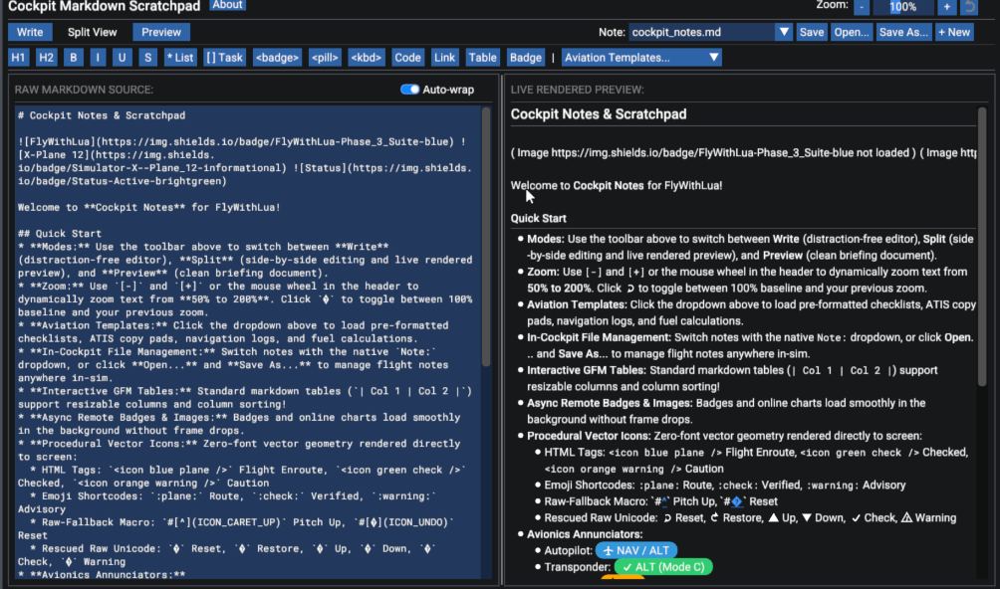

---

## 3. Common Design Standards & Ecosystem Philosophy

ImGee follows strict architectural patterns established by the broader Dear ImGui community:

### 3.1 Omar Cornut's Ecosystem Standard (Single Point of Discovery)
In official Dear ImGui extensions and ecosystem projects (such as `implot`, `imgui_club`, and `imnodes`), Omar Cornut explicitly advocates extending `namespace ImGui { ... }`.
* **Discoverability & Autocomplete:** Modern C++ developers rely heavily on IDE autocomplete. When typing `ImGui::`, developers immediately discover every capability available across the toolkit in one place.
* **Zero Cognitive Overhead:** Developers are not forced to memorize artificial root namespaces (such as `extgui::` or `imgee::`) or manage scattered `using namespace` directives.

### 3.2 Second-Level Sub-Namespaces for Subsystems
While extending `namespace ImGui` is essential, placing heavy packages directly into the root risks colliding with future Dear ImGui core functions. ImGee cleanly encapsulates its multi-function subsystems within **second-level sub-namespaces**:
* `ImGui::TimedTooltip::`
* `ImGui::Markdown::` (with official shorthand alias `ImGui::MD::`)

*(Typography helpers such as `ImGui::ImFontRole`, `ImGui::SetFontRole`, `ImGui::ScopedFontRole`, and `ImGui::StyledText` live directly in `ImGui::` alongside standard text APIs.)*

Sub-namespaces allow extensions to reuse Dear ImGui's standard vocabulary without ambiguity:
```cpp
ImGui::TimedTooltip::Text("Hover-delayed stationary tooltip.");
ImGui::MD::TextWrapped("Configure your **workspace** below.");
```

### 3.3 Convenient Root Shorthands & Global Scope
* Shorthands like `ImGui::TextMD(...)` and `ImGui::ButtonMD(...)` are exposed in the root `ImGui::` namespace.
* Defining `#define IMGEE_ENABLE_GLOBAL_NAMESPACES` publishes `Markdown::`, `MD::`, and `TimedTooltip::` directly to the global scope for maximum brevity.

### 3.4 Working with Immediate-Mode Widgets in C++
Developers consuming ImGee widgets should expect standard Dear ImGui immediate-mode conventions:
* **Caller-Owned State:** Controls accept pointers to caller-owned primitives (e.g. `float* value`, `bool* open`). ImGee never allocates heap memory for persistent values unless explicitly requested.
* **Ambient Context:** Functions implicitly draw into the currently active `ImGuiWindow` and utilize Dear ImGui's ambient style and font stacks.
* **ID Stack Safety:** Push and Pop IDs (`ImGui::PushID` / `ImGui::PopID`) apply seamlessly across all ImGee controls, rotary knobs, and reset buttons.

### 3.5 The ImGee UX Design Manifesto (Human Factors Standard)
For the full architectural philosophy, ergonomics theory, and interaction rules governing ImGee, see the companion document:
* **[The ImGee UX Design Manifesto](ImGee_UX_Design_Manifesto.md)** (`ImGee_UX_Design_Manifesto.pdf`):
  * **Part I: The Architectural Foundation (The Framework's Promise):**
    * **Flight Deck Cognitive Reality:** Protecting Expert Mode (muscle memory & peripheral vision); eliminating Thinking Mode interruptions.
    * **The Zero-Inert Law:** Mandatory active cursor affordances (`Hand`, `ResizeNS`, `ResizeEW`, `TextInput`) for all interactive elements.
    * **First-Gesture Discoverability:** Natural list ordering (+1 on scroll down) and eliminating initial-gesture false negatives.
    * **Monotonic vs. Categorical Dialectic:** Strict rules for clamping (`wrap = false`) vs. circular wrapping (`wrap = true`).
    * **The Lens UI Principle:** Modal focus latching with > 6 px hysteresis during open-menu wheel navigation.
    * **Container Pass-Through:** Closed pulldowns pass scroll events through to parent scrollable containers.
    * **Stationary, Polite Assistance (TimedTooltips):** Why stock Dear ImGui tooltips fail (instant-flash strobing, mouse-bound jitter, target occlusion) and why stationary, dwell-verified TimedTooltips prevail.
    * **Reversibility & Non-Destructive Defaults:** 1-click restore (`↺`) with instant undo history.
  * **Part II: The Developer's Covenant (Promises to the End User):**
    * The Seven Sacred Promises: Banish legacy tooltips, match data physics, honor natural list order, eliminate ambiguous cursor pixels, prevent scroll traps, offer 1-click restore, and prioritize semantic scanning hierarchy.
  * **Appendix A: Canonical Verification Checklists:** Turnkey compliance checklists for framework architects and downstream plugin developers.

---

## 4. Generic Dear ImGui Core & Multi-Language Bindings

**ImGee core is 100% generic Dear ImGui.** Nothing in the C++ toolkit inherently requires any simulator or platform-specific framework -- any desktop application, studio/audio/CAD tool, game engine, or simulation host utilizing Dear ImGui can consume ImGee directly.

### 4.1 LuiGee: Lua Bindings for FlyWithLua
For Lua developers in the X-Plane ecosystem, ImGee's UI capabilities are brought directly into the Lua scripting environment as **LuiGee**.
* **Broad Simulator Support:** Available for ImGui-based windows in FlyWithLua across all X-Plane versions from **X-Plane 11.20 through the latest X-Plane 12+ releases and into the future**.
* **Zero-Boilerplate Scripting:** Exposes animated switches, rotary knobs, vector icons, and timed tooltips to Lua developers with idiomatic syntax.

### 4.2 Community & Other Language Bindings
We are actively considering bindings for other environments and programming languages (such as **Python**, **Rust**, and **C#**). If developers in the wider Dear ImGui ecosystem are interested in bringing ImGee to other platforms or developing language wrappers, we warmly welcome community discussions and collaboration!

---

## 5. Integration Models & Include Paths

One of the central design principles of **ImGee** is immediacy: you do not need to initialize subsystems, configure factories, or add `.cpp` files to your build scripts. Everything is configured and ready out of the box in a single `#include`.

### 5.1 Standalone Clone or Git Submodule (Recommended)
When consuming **ImGee** directly from its standalone Git repository (e.g. `git submodule add https://github.com/slgoldberg/ImGee.git third-party/ImGee`), include `imgee.h`:

```cpp
// When ImGee/ itself is on your -I include path:
#include "imgee.h"

// Or when the parent directory of ImGee/ is on your -I include path:
#include "ImGee/imgee.h"
```

### 5.2 A-La-Carte & Order-Independent Inclusion
ImGee is architecturally modular and order-independent -- cross-extension bridges (such as `ImGui::TimedTooltip::TextMD` and rich Markdown widget tooltips) activate automatically regardless of include order:

```cpp
// Option A: Include only extensions (TimedTooltip, Markdown, Typography, Viewport, DocViewer):
#include "ImGee/extensions.h"

// Option B: Include only immediate-mode UI widgets (Knobs, Toggles, Wheel Sliders, Badges, Icons):
#include "ImGee/widgets.h"

// Option C: Cherry-pick individual headers in any order:
#include "ImGee/widgets/imgui_knobs.h"
```

### 5.3 Standalone GPU Texture & Lifecycle Hook (`ImGee::HostBackend`)
All vector widgets, icons, themes, typography, tooltips, and Markdown text/tables work with zero host callbacks. If your standalone Dear ImGui app (GLFW, SDL, Win32, Metal, Vulkan, DX11/DX12) also renders **local disk or async HTTP/HTTPS Markdown images**, register your texture upload/delete callbacks via `ImGee::SetHostBackend(...)` and call `ImGee::Shutdown()` prior to tearing down your graphics device.

### 5.4 Turnkey X-Plane Integration via `ImgWindow`
When consuming **ImGee** inside an X-Plane project via `ImgWindow` (where `ImGee` is mounted at `ImgWindow/contrib/ImGee/`):

```cpp
// Recommended when the parent folder of ImgWindow/ is on your -I include path:
#include "ImgWindow/contrib/imgee.h"

// Or if ImgWindow/ itself is on your -I include path (e.g. imgui4xp):
#include "contrib/imgee.h"
```

*(Note: `#include "contrib/imgee.h"` includes strictly ImGee, whereas `ImgWindow`'s `#include "contrib.h"` serves as its broader multi-package community umbrella header. Always match exact filename casing so Linux builds succeed cleanly.)*

### 5.5 Ready by Default Out of the Box
Every capability described in this manual is **100% active and enabled out of the box**:
* **Procedural Vector Icons** resolve automatically without font atlas baking.
* **Stationary Timed Tooltips** eliminate cursor jitter and support rich Markdown out of the box.
* **Tactile Input Affordances** (sliders with reset/undo buttons, rotary knobs, animated toggles, directional pulldowns) compile cleanly into `ImGui::`.
* **Formatted Markdown, GFM Tables & 3-Tier Images** render interactive documentation with zero external build dependencies (and bridge automatically to `ImgWindow` texture management whenever `ImgWindow.h` is present).

*(For projects with strict binary constraints or symbol conflicts, granular `IMGEE_DISABLE_*` opt-outs are documented in [Appendix A](#appendix-a-preprocessor-opt-out-configuration--build-matrix)).*

---

## 6. Orientation Roadmap & User Manual Directory

To guide developers through the suite, this manual is structured into dedicated, modular reference sections:

* **Part I: Flagship Extensions Suite**
  * **[TimedTooltip Extension](#7-flagship-extension-stationary-timed-tooltips-imgui_tooltip_exth)**: Stationary delayed tooltips, screen-edge clamping, and scroll dismissal.
  * **[Markdown Extension](#8-flagship-extension-rich-markdown-engine--gfm-tables-imgui_markdown_exth)**: CommonMark rendering, GFM tables & callouts, 3-tier floated/lightbox images, and custom tags.
  * **[Typography & DocumentViewer](#9-foundation-extension-semantic-typography--font-roles-imgui_font_rolesh--imgui_styled_texth)**: `ImFontRole` 9-slot registry, baseline-aligned `StyledText`, and standalone `ImGui::DocumentViewer`.
* **Part II: Immediate-Mode UI Widgets & Themes Catalog**
  * **[Procedural Vector Icons](#101-procedural-vector-icon-engine--glyphs-imgui_iconsh)**: Zero-texture vector engine and `IconButton` / `ButtonIcon`.
  * **[Rotary Knobs & Dimmer Dials](#102-rotary-knobs--dimmer-dials-imgui_knobsh)**: 270° potentiometers with ticks, readout, 2-step `OFF` detents, and 1-click reset.
  * **[Mouse-Wheel Sliders with Reset](#103-mouse-wheel-sliders--reset-chasers-imgui_mouse_wheel_controlsh)**: Sliders and combos with natural wheel stepping and 1-click Reset-with-Undo.
  * **[Badges, Pills & Status Capsules](#104-badges-pills--status-capsules-imgui_badgesh)**: Badges, pills, named-icon capsules (`PillNamed`), and `<kbd>` keycaps.
  * **[Tactile Animated Toggles](#105-tactile-animated-toggle-switches-imgui_toggle_buttonsh)**: Animated toggle switches and segmented dual toggles with per-state tooltips.
  * **[Activity Spinners & Countdown Dials](#106-procedural-activity-spinners--countdown-dials-imgui_spinnersh)**: Activity spinners, progress rings, and radial countdown timers.
  * **[Directional Popups & SelectPulldown](#107-directional-popups-item-anchoring--selectpulldown-imgui_popup_menush)**: Directional blossoming popups, headroom queries, and 1-line selectors with Lens UI.
  * **[Clickable Links & Copy Buttons](#108-clickable-links-cursor-affordances--copy-buttons-imgui_clickable_linksh--imgui_copy_buttonh)**: Active `Hand` cursor wrappers, click-to-toggle tooltips, and anti-twitch clipboard buttons.
  * **[Non-Blocking File Dialogs & Pickers](#109-non-blocking-file-dialogs--toolbar-pickers-imgui_file_dialogh)**: Non-blocking `OpenFileDialog`, `SaveFileDialog`, and inline `FilePickerCombo`.
  * **[Curated Color Themes](#1010-curated-color-themes-themesimgui_stylesh)**: Turnkey `Charcoal`, `Rusty`, and `Paper Light` palettes replacing Dear ImGui's stock neon blue.
* **Part III: Reference & Standards**
  * **[Appendix A: Preprocessor Opt-Out Configuration](#appendix-a-preprocessor-opt-out-configuration--build-matrix)**: Granular `IMGEE_DISABLE_*` switches for binary size and symbol isolation.
  * **Companion Standard: [The ImGee UX Design Manifesto](ImGee_UX_Design_Manifesto.md)** (`ImGee_UX_Design_Manifesto.pdf`): Canonical human factors and interaction engineering tenets.

---

## 7. Flagship Extension: Stationary Timed Tooltips (`imgui_tooltip_ext.h`)

Vanilla tooltips follow the cursor frame-by-frame like a bee, creating visual distraction, resetting scroll state, and clipping off-screen when near monitor borders. ImGee elevates Dear ImGui tooltips to be stationary, anchored, and cursor-aware:

```cpp
// 1. Plain text stationary tooltip
ImGui::Button("Flaps 15");
ImGui::TimedTooltip::Text("Takeoff flap detent. Generates additional lift with moderate drag.");

// 2. Full Markdown stationary tooltip
ImGui::Button("GPWS");
ImGui::TimedTooltip::TextMD(
    "### Ground Proximity Warning System\n"
    "* **Terrain Ahead:** Pull up immediately.\n"
    "* **Glideslope:** Deviation exceeds 1.3 dots."
);
```

### Key Tooltip Affordances:

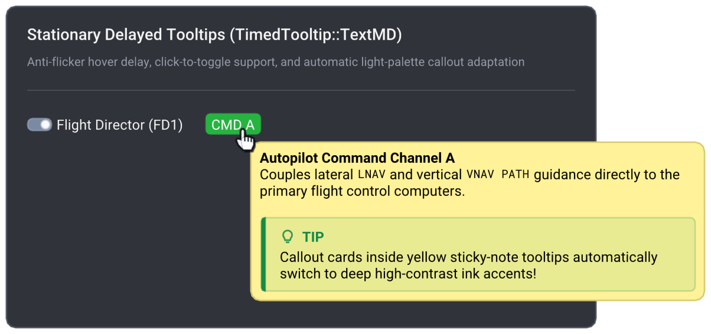

* **Initial Dwell Delay:** Prevents accidental popup flashing while sweeping the mouse across dense control panels.
* **Stationary Anchor:** Freezes in position once visible, allowing effortless, relaxed reading.
* **Smart Screen Clamping:** Automatically nudges inside the display or host window boundaries.
* **Wheel-Defeat Dismissal:** Rolling the mouse wheel immediately closes the tooltip so it never blocks scrolling views.
* **Base-Font Isolation:** When `TooltipConfig::font` is left `nullptr`, tooltips automatically resolve the base UI font (`ImFontRole::Regular`, `io.FontDefault`, or `io.Fonts->Fonts[0]`) during both pre-measurement and rendering -- so calling `TimedTooltip` inside a compact caller `PushFont(...)` scope never shrinks body text relative to inline bold, italic, or monospace spans.
* **Font Scaling & Damped Compression:** Automatically dampens font zoom (using a non-linear curve with a 0.90f floor and 1.65f ceiling) so tooltips stay readable without ballooning into unwieldy screen-filling rectangles on ultra-wide or 4K monitors.

<br clear="all"/>

---

## 8. Flagship Extension: Rich Markdown Engine & GFM Tables (`imgui_markdown_ext.h`)

The ImGee Markdown engine transforms plain text strings into fully interactive in-app documentation:

```cpp
const char* doc = R"(
# Flight Operations Manual
The **Autopilot Flight Director System** (AFDS) manages aircraft trajectory.

### Status Annunciations
| Mode | Status | Armed | Minimum Speed |
| :--- | :---: | :---: | :--- |
| **LNAV** | <badge=success>ENGAGED</badge> | Yes | `V2 + 15` |
| **VNAV** | <badge=warning>ARMED</badge> | Yes | `250 KTS` |
| **ILS** | <badge>STANDBY</badge> | No | `VREF + 5` |

> [!NOTE]
> Ensure barometric altimeters are set to standard pressure (29.92 IN HG / 1013 HPA) when passing transition altitude.
)";

ImGui::Markdown::Text(doc);
```

### Key Markdown Affordances:
* **Tristate Column Sorting:** Click any column header to cycle Ascending -> Descending -> Default sort.
* **Delayed Table Control Tooltips:** Sortable headers, column dividers, and the right-edge width grip automatically display context-aware `TimedTooltip` guidance (announcing the next step in the tristate sort cycle or A/B layout toggle), with `MarkdownConfig::enableTableTooltips`, `MarkdownConfig::tableTooltipCallback`, and per-table `<!-- table-preset: tooltips=off ... -->` or per-column `col-tooltips="A|B|off"` / `tip0="..."` overrides. When `TimedTooltip` is disabled and no custom callback is set, table controls stay silent rather than falling back to instant-pop tooltips.
* **Interactive Drag Sizing:** Adjust column dividers directly with instant mouse feedback.
* **Persistent Presets:** Save and restore column widths via inline comment tags (`<!-- table-state: ... -->`).
* **Native Blockquotes & GFM Callout Cards:** Standard `> ...` blockquotes (including nested `> > ...` quotes) and all five GitHub-Flavored Markdown callouts (`> [!NOTE]` / `[!INFO]`, `[!TIP]`, `[!IMPORTANT]`, `[!WARNING]`, `[!CAUTION]` in both multi-line and inline forms, plus `<callout type=... title="...">` and `<blockquote>` tags) render out of the box with zero-font procedural vector icons and full nesting support for code blocks (including quoted code fences) and tables.
* **Aligned & Text-Wrapping Figures, Captions, & Interactive Lightbox:** Markdown images support horizontal block alignment (`=68% center`, `align=right`, `<center></center>`), true text-wrapping floats (`float=left` / `float=right` and HTML `` with mid-paragraph reflow, optional `gap=` / `margin=` spacing, explicit `<clear/>` / `<br clear="all"/>` / `<!-- clear -->` clearing, scoped end-of-card clearance, and narrow-viewport fallback), proportional content-zoom scaling (`nozoom` / `scale=fixed` opt-out), centered inline-Markdown figure captions (`caption`, `caption="Figure 1: **Overview**"`, `nocaption`, `mdConfig.showImageCaptions`), `baseDir` documentation subfolder fallbacks (`images/`, `../`, `../images/`), and an opt-in same-context click-to-enlarge lightbox (`lightbox` / `zoom` / `expand`, `nolightbox`, `mdConfig.enableImageLightbox`) clamped to the host window bounds with a top-right hover zoom strip (`[-]  [100%]  [+]  [↺]`), smooth mouse-wheel zoom, drag-to-pan, and zero secondary OS windows.
* **Two-Layer Zoomable Document Viewports (`imgui_zoomable_viewport.h`):** `ImGui::ZoomableViewportState` + `ImGui::BeginZoomedViewport(...)` / `ImGui::EndZoomedViewport()` + `ImGui::ZoomViewportControls(...)` keep header/footer chrome at crisp `1.0x` while zooming scrollable inner content smoothly across `[0.50x .. 2.50x]`.
* **Code Block Copy Buttons:** Shaded code blocks automatically include one-click clipboard copying with 1.5s visual feedback.

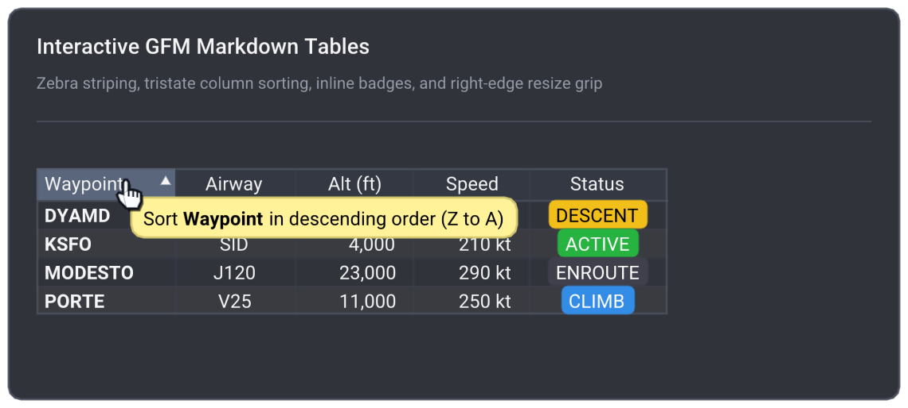

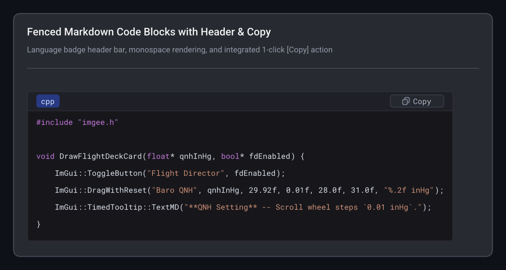

### 8.1 Blockquotes, GFM Callout Cards & Text-Wrapping Image Floats

Standard CommonMark `> ...` blockquotes and all five GitHub-Flavored Markdown alerts (`> [!NOTE]`, `> [!TIP]`, `> [!IMPORTANT]`, `> [!WARNING]`, `> [!CAUTION]`) render with zero-font procedural vector icons and a splitter-free `ImDrawList` underlay -- allowing callout cards to contain fenced code blocks, GFM tables, and nested quotes freely:

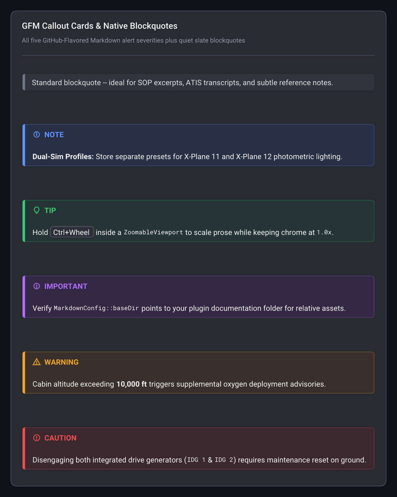

For illustrated manuals and checklists, images float left or right with true mid-paragraph text reflow via either Markdown modifiers (`float=right` / `float=left`) or standard GitHub/HTML `` tags (paired with `<br clear="all"/>` when clearing past a tall card early):

```markdown


Under **Normal Law**, redundant air-data inertial reference units continuously monitor load factor and airspeed...

<br clear="all"/>
```

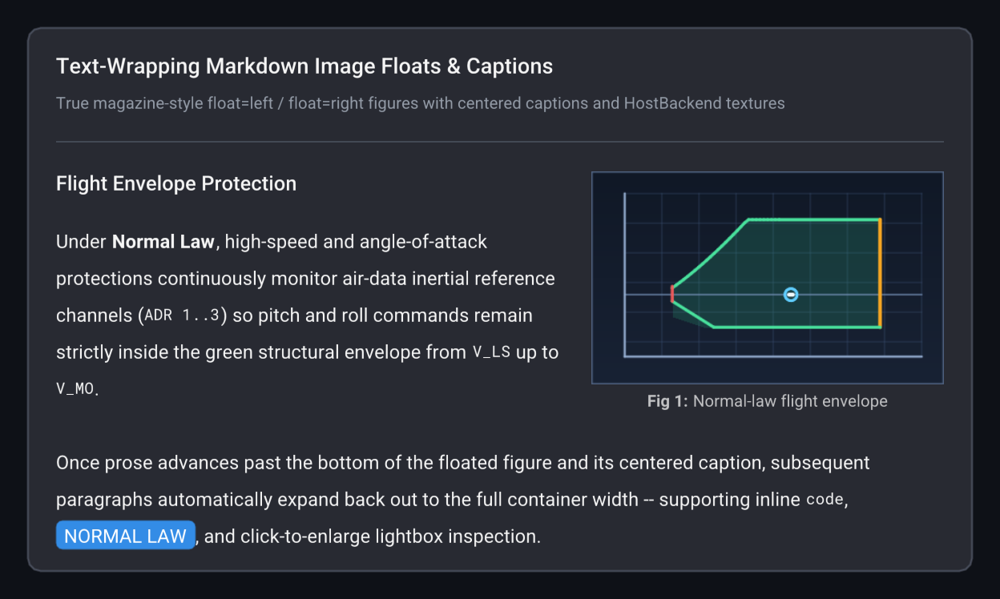

### 8.2 Declarative Semantic Style Tags & Macro Aliases

Rather than writing verbose C++ code or nesting raw push/pop color commands, developers can define custom semantic Markdown tags dynamically during plugin startup:

#### 1. Semantic Style Tags (`RegisterMarkdownStyleTag`)
Map custom tags to composite typography styles combining colors, weights, fonts, and background capsules:

```cpp
// Register declarative styles during plugin initialization:
ImGui::RegisterMarkdownStyleTag("cam", "green bold mono");
ImGui::RegisterMarkdownStyleTag("viewmode", "mono bg=#88888840");
ImGui::RegisterMarkdownStyleTag("alert", "bg=#ff4444 fg=#ffffff bold");
```

Use them seamlessly inside any Markdown text:
```cpp
ImGui::MD::Text("Set camera to <cam>Heading</cam> mode or switch to <viewmode>Circle view</viewmode>.");
```

#### 2. Macro Template Tag Aliases (`RegisterMarkdownTagAlias`)
Register reusable tag macros that expand into arbitrary Markdown syntax with `%s` placeholder substitution:

```cpp
// Register tag templates:
ImGui::RegisterMarkdownTagAlias("opt", "<pill #444444 fg=#ffffff>%s</pill>");
ImGui::RegisterMarkdownTagAlias("callsign", "**`%s`**");
ImGui::RegisterMarkdownTagAlias("hotkey", "<kbd>%s</kbd>");
```

When evaluated, `<opt>Circle view</opt>` expands into `<pill #444444 fg=#ffffff>Circle view</pill>`, complete with background capsule geometry and baseline alignment.

#### 3. Hex Alpha Transparency & Auto-Contrast
* **Alpha Channels:** Color specifications support 4-digit (`#RGBA`) and 8-digit (`#RRGGBBAA`) hex codes (e.g. `bg=#88888840` or `bg=#8884` for a 25% translucent charcoal pill).
* **Auto-Contrast:** In capsule tags (`<badge>`, `<pill>`), bare color tokens default to the background color (`bg_color`), and the text foreground color is automatically chosen based on perceived luminance (white text on dark capsules, dark text on bright capsules). Explicit `fg=` or `text=` overrides this auto-calculation when desired.
* **Font Role Integration:** Style tags automatically pull loaded fonts from the `ImFontRole` registry:
  * `mono` / `monospace` → Slot 5 (`Monospace`) with fallback to Slot 7 (`MonospaceMedium`)
  * `bold` → Slot 3 (`Bold`) with fallback to Slot 4 (`BoldLarge`)
  * `italic` → Slot 6 (`Italic`) with fallback to Slot 8 (`BoldItalic`)

---

## 9. Foundation Extension: Semantic Typography & Font Roles (`imgui_font_roles.h` & `imgui_styled_text.h`)

Information-dense user interfaces require clear typographic hierarchy: primary readouts and section banners need crisp, legible headings; captions and secondary annotations need compact subtext; and identifiers, paths, and numeric columns require clean monospaced alignment.

ImGee provides two complementary typography systems:
1. **Semantic Font Roles (`ImGui::ImFontRole`):** A 9-slot canonical font registry (Slots 0..8, plus semantic `Heading1`..`Heading3` and `Tiny` roles) linking logical design roles to loaded rasterized fonts with automatic 4-tier fallbacks.
2. **Inline Styled Text Engine (`ImGui::StyledText`):** Lightweight XML-style tag parsing with baseline alignment, formatted variadic `printf` support, and zero Markdown document overhead.

### 9.1 The `ImGui::ImFontRole` Registry

```cpp
namespace ImGui {
    enum class ImFontRole {
        Regular = 0,        // Slot 0: Primary interface font (e.g. 14px)
        Title,              // Slot 1: Section headers, dialog titles (e.g. 16px)
        Small,              // Slot 2: Captions, annotations, secondary subtext (e.g. 12px)
        Bold,               // Slot 3: Strong emphasis, table headers (e.g. Bold 14px)
        BoldLarge,          // Slot 4: Hero banners, major readouts (e.g. Bold 16px)
        Monospace,          // Slot 5: Datarefs, callsigns, frequencies (e.g. Mono 14px)
        Italic,             // Slot 6: Citations, hints, metadata (e.g. Italic 14px)
        MonospaceMedium,    // Slot 7: Numeric avionics readouts, dials (e.g. Mono Medium 15px)
        BoldItalic,         // Slot 8: Strong soft emphasis (e.g. Bold-Italic 14px)
        Heading1,           // Markdown H1 banner title (falls back to BoldLarge -> Title)
        Heading2,           // Markdown H2 section header (falls back to Title -> Bold)
        Heading3,           // Markdown H3 subsection header (falls back to Bold)
        Tiny,               // Micro subtext, footnotes (falls back to Small)
        Count
    };
}
```

Fonts loaded into slots `0..8` of `ImGui::GetIO().Fonts` map automatically, or you can bind any `ImFont*` explicitly via `ImGui::SetFontRole(...)` and apply roles safely with RAII `ImGui::ScopedFontRole`:

```cpp
// Register explicitly during initialization:
ImGui::SetFontRole(ImGui::ImFontRole::MonospaceMedium, avionicsMonoFont);

// Push & pop safely via RAII guard during rendering:
{
    ImGui::ScopedFontRole guard(ImGui::ImFontRole::Title);
    ImGui::TextUnformatted("Flight Management System");
}
```

### 9.2 Inline Styled Text (`ImGui::StyledText`)
When you want rich typography without building a full CommonMark AST, `ImGui::StyledText` parses XML-style tags (`<b>`, `<i>`, `<mono>`, `<huge>`, `<small>`, `<color>`, `<badge>`, `<pill>`) inline with continuous baseline alignment.

It supports full `printf`-style formatted variadic arguments out of the box with zero runtime boilerplate:

```cpp
// 1. Variadic formatted text:
ImGui::StyledText("ALT: <huge>%d</huge> <small>%s</small> | SPD: <mono>%.1f</mono> <small>KTS</small>",
                  altitude, altUnits, airspeed);

// 2. Dynamic status pills with computed values:
ImGui::StyledText("Status: <pill #2ecc71>%s</pill> | VOR: <mono>%s</mono>",
                  statusName, identStr);

// 3. Unformatted pointer pairs:
ImGui::StyledTextUnformatted(bufStart, bufEnd);
```

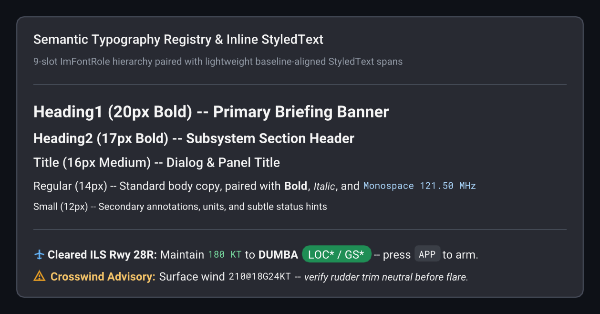

### 9.3 Standalone Markdown Document Viewer (`extensions/DocViewer/imgui_doc_viewer.h`)
When your desktop application, studio tool, or plugin includes a user manual, release notes, or interactive reference guide, `ImGui::DocumentViewer` provides a complete, zero-boilerplate viewer built on top of `BeginZoomedViewport` and `MarkdownExt`:

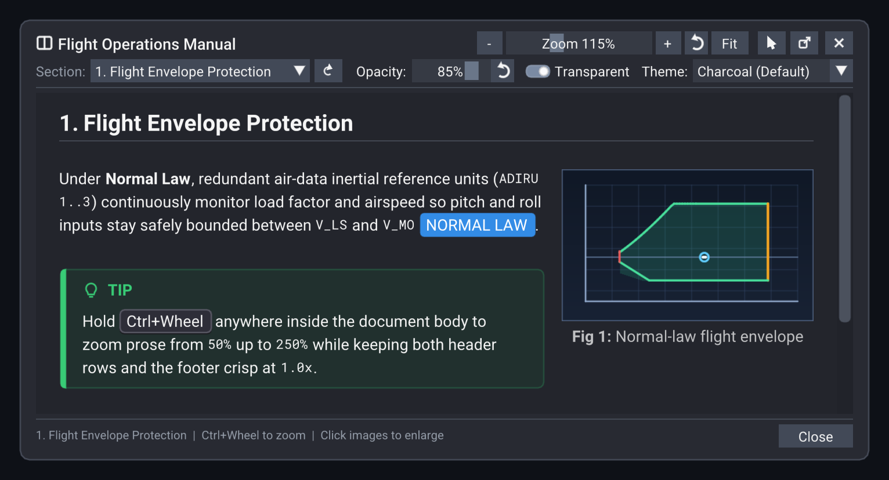

* **Two-Row `1.0x` Header Chrome:** Keeps the responsive title, repeating `[-]` / `[+]` zoom steppers, mouse-wheel `Zoom` slider (`50%..250%`), 1-click A/B zoom reset/undo (`↺` / `↻`), Table-of-Contents `SelectPulldown` with 1-click scroll-to-top / return-to-reading-spot (`↺` / `↻`), zero-shift `Opacity:` + `Transparent` controls, and 5-preset `Theme:` picker (`Charcoal (Default)`, `Rusty (Bronze)`, `ImGui Dark`, `ImGui Classic`, `Paper Light`) crisp at `1.0x` scale while zooming document prose independently.
* **Automatic Section Jump, Scroll Return, & `#heading-slug` Links:** Scans `#`, `##`, and `###` ATX headings (skipping fenced code blocks and blockquotes) into the Row 2 TOC pulldown, pairs it with a `ResetButton` (`showScrollResetButton = true`) that jumps cleanly to the top of the document and restores your exact previous `ScrollY` spot in one click, and intercepts internal `[Jump](#section-slug)` links to scroll directly to the matching section.
* **Optional Host Window Hooks:** Exposes clean boolean flags and function-pointer callbacks in `DocumentViewerConfig` (`showFitButton`, `showCursorToggle`, `showPopOutButton`, `showVrButton`, `showCloseButton`, `showReloadButton`, `externalPdfPath`) with zero platform SDK dependencies.

```cpp
static ImGui::DocumentViewerState s_ManualState;

ImGui::DocumentViewerConfig docCfg;
docCfg.title           = "User Manual & Reference";
docCfg.baseDir         = "assets/docs";
docCfg.externalPdfPath = "assets/docs/User_Manual.pdf";
docCfg.showCloseButton = true;

if (!ImGui::DocumentViewer("##UserManual", manualMarkdown, s_ManualState, &docCfg)) {
    s_ShowManualWindow = false; // Closed via Row 1 [X] or optional footer Close button
}
```

---

## 10. Immediate-Mode UI Widgets & Themes Showcase

Standard Dear ImGui controls are built primarily for developer overlays and debug menus. ImGee extends ImGui with a complete suite of tactile, ergonomic immediate-mode widgets designed for responsive desktop, studio, and simulation workflows.

### 10.1 Procedural Vector Icon Engine & Glyphs (`imgui_icons.h`)

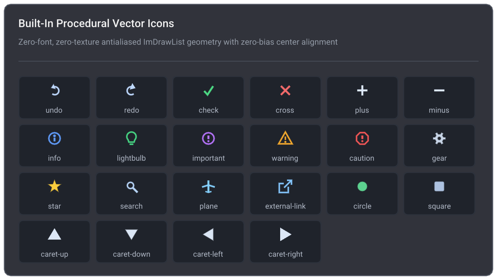

Standard Dear ImGui plugins often suffer from missing glyphs when attempting to display symbols like reset arrows (`↺`), sort carets (`▲`, `▼`), checkmarks (`✓`), gears (`⚙`), or airplanes (`✈`).

ImGee includes a **zero-texture, zero-font procedural vector engine** (`imgui_icons.h`) that submits antialiased geometric primitives (lines, arcs, bezier curves, and triangles) directly to Dear ImGui's active `ImDrawList` whenever a custom texture or icon-font glyph is not registered.

<br clear="all"/>

#### Vector Push-Buttons: `IconButton` & `ButtonIcon`
Turnkey button helpers render procedural vector icons with `Hand` cursor feedback and optional `TimedTooltip`s:

```cpp
// 1. Square Icon-Only Button with native hand cursor and tooltip
if (ImGui::IconButton("##ResetHdg", "undo", ImVec2(0, 0), "Reset Heading to 360°")) {
    s_Heading = 360.0f;
}

// 2. Icon + Text Button (Icon on Left or Right)
if (ImGui::ButtonIcon("Settings", "gear")) {
    OpenSettingsDialog();
}
if (ImGui::ButtonIcon("Next Waypoint", "caret-right", ImVec2(160, 0), /*icon_on_right=*/true)) {
    AdvanceWaypoint();
}
```

---

### 10.2 Rotary Knobs & Dimmer Dials (`imgui_knobs.h`)
Horizontal sliders take up wide column footprints when laying out audio mixers, lighting dimmers, hardware control strips, or instrument panels. `ImGui::Knob` implements a compact rotary potentiometer:

```
          . - ~ ~ - .
      . '    .---.    ' .
    /       /     \       \
   :       |   *   |       :   <- 270° "Omega" Arc
    \       \     /       /       with Open Deadband at 6 o'clock
      . '    '---'    ' .
          ' -  *  - '
             OFF
```

#### Features:
1. **270-Degree "Omega" Arc:** An open deadband at 6 o'clock immediately communicates an interactive dial.
2. **Tactile Two-Step Detente Switch:** Counter-clockwise rotation dims smoothly down to minimum operating value (e.g., 5%). A deliberate extra mouse-wheel click or drag snaps across the detente gap into the powered-down `"OFF"` state. Rotating clockwise from `"OFF"` snaps instantly back to minimum active power.
3. **Scroll-Wheel Primary:** Hover and roll the wheel with fine-tuning modifiers (`Shift` for `0.1x` fine, `Ctrl` for `2.0x` coarse).

```cpp
static float s_PanelLight = 0.75f;

// 1. Standard Knob with perimeter ticks and value readout below:
ImGui::Knob("Panel Light", &s_PanelLight, 0.0f, 1.0f, "%.2f",
            0.0f /* auto radius */, 0.01f /* wheel step */,
            ImGuiKnobFlags_ShowTicks | ImGuiKnobFlags_ValueBelow);

// 2. Composite Knob with 1-Click Reset Chaser (default comes right after &value):
static const float s_DefaultGain = 0.80f;
ImGui::KnobWithReset("Monitor Gain", &s_PanelLight, s_DefaultGain,
                     0.0f, 1.0f, "%.0f%%");
```

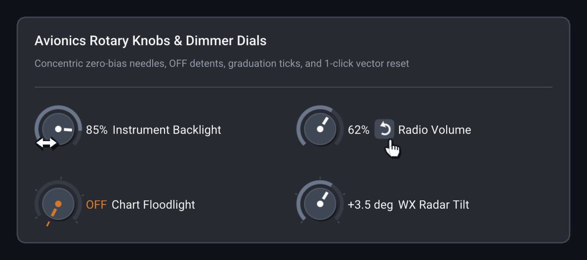

---

### 10.3 Mouse-Wheel Sliders & Reset Chasers (`imgui_mouse_wheel_controls.h`)

Users often hesitate to experiment with calibrated parameters -- whether tuning display gamma, shader curves, audio trim, or simulation physics -- for fear of losing their working baseline.

ImGee solves this with **Inline 1-Click Restore-to-Default Chasers** (with automatic 1-click Undo/Redo A/B comparison):

```cpp
static float s_Gamma = 2.2f;
static const float s_DefaultGamma = 2.2f;

// Renders slider with natural mouse-wheel stepping and an abutting Reset/Undo button.
// Clicking resets to s_DefaultGamma; clicking again swaps back to your previous value!
ImGui::SliderWithReset("Display Gamma", &s_Gamma, s_DefaultGamma, 1.0f, 3.0f, "%.2f");
```

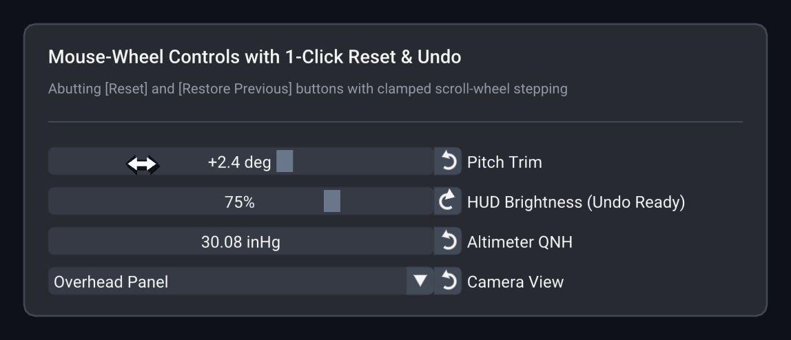

---

### 10.4 Badges, Pills & Status Capsules (`imgui_badges.h`)

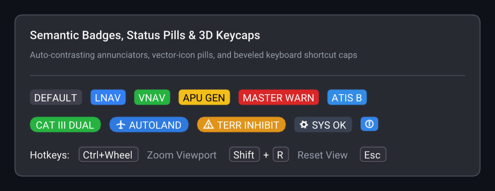

Dense dashboards, inspector panels, and status bars need clear, glanceable capsules for modes, warnings, and keyboard shortcuts without running a full Markdown parser:

* **Auto-Contrasting Capsules (`Badge` / `Pill`):** Computes ITU-R BT.601 luminance of the background color and chooses crisp dark or white text automatically while centering glyphs on the TrueType baseline.
* **Icon Capsules & Keycaps (`PillNamed` / `Kbd`):** Combines procedural vector icons (or named memory textures) with status capsules, alongside 3D beveled `<kbd>` shortcut chips.

<br clear="all"/>

```cpp
ImGui::Pill("ONLINE", ImVec4(0.1f, 0.8f, 0.3f, 1.0f));
ImGui::SameLine();
ImGui::PillNamed("check", "SYNCED", ImVec4(0.2f, 0.6f, 1.0f, 1.0f));
ImGui::SameLine();
ImGui::Kbd("Ctrl+Z");
```

---

### 10.5 Tactile Animated Toggle Switches (`imgui_toggle_buttons.h`)

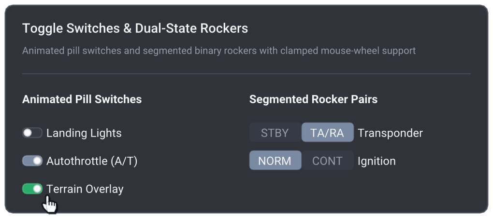

Replaces plain form checkboxes with smooth, `io.DeltaTime`-animated pill switches (`ToggleButton`) and joined two-way mode selectors (`ToggleButtons`):

* **Clamped Wheel & Per-State Tooltips:** Spinning the mouse wheel over the switch track toggles state cleanly without wrapping, while hovering the label lets scrollable parent panels scroll undisturbed. Optional `(off_tooltip, on_tooltip)` strings attach state-aware `TimedTooltip`s directly.

<br clear="all"/>

```cpp
static bool s_LivePreview = true;
if (ImGui::ToggleButton("Live Preview", &s_LivePreview,
                        "Preview is **OFF**.", "Preview is **ON**.")) {
    RefreshViewport();
}
```

---

### 10.6 Procedural Activity Spinners & Countdown Dials (`imgui_spinners.h`)

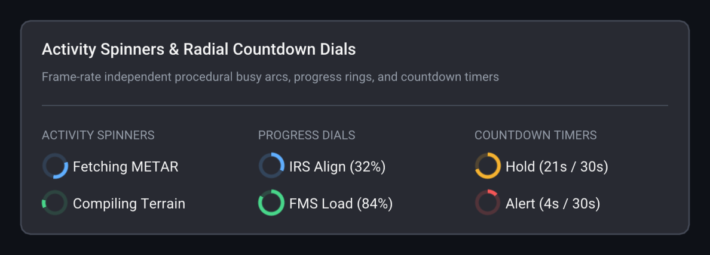

Antialiased `ImDrawList` activity spinners, progress rings, and 12-o'clock radial countdown timers with zero texture assets and built-in click-to-toggle `TimedTooltip` support:

* **Ambient Font Scaling:** Passing `radius = 0.0f` scales stroke thickness and diameter automatically with `ImGui::GetFontSize()`.

<br clear="all"/>

```cpp
ImGui::Spinner("Syncing datalink...");
ImGui::RadialTimer("Approach Leg", s_LegFraction, 14.0f, 3.0f, IM_COL32(234, 179, 8, 255));
```

---

### 10.7 Directional Popups, Item Anchoring & SelectPulldown (`imgui_popup_menus.h`)

Provides precision item-anchored popup placement, upward blossoming for bottom-docked status bars, and compact 1-line option selectors with Lens UI mouse-wheel interaction:

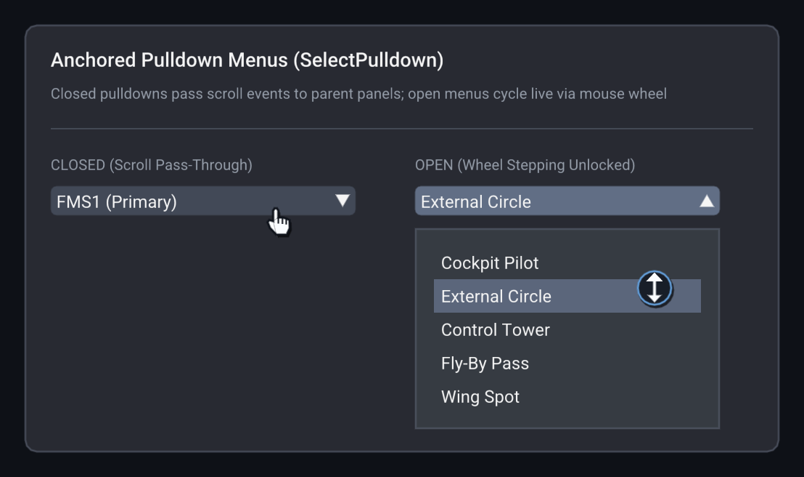

* **Item-Anchored Popups (`OpenPopupAtItem` & `BeginAnchoredPopup`)**:
  Positions dropdowns relative to the preceding item's bounding box (`GetItemRectMin`/`Max`). Supports `ImGuiPopupAnchor_BelowItem` (standard dropdown) or `ImGuiPopupAnchor_AboveItem` (blossoms upward for bottom bars and docks) with font-scale invariance and muscle-memory toggle protection.
* **1-Line Option Selector (`SelectPulldown` / `SelectPulldownMD`)**:
  - **Scroll Pass-Through When Closed**: Ignores mouse-wheel events while closed so parent scrollable windows never accidentally change settings during scroll navigation.
  - **"Lens UI" Selection-Latched Tooltips**: When spinning the mouse wheel inside an open pulldown menu, per-item tooltips dynamically latch onto the newly selected item (`*current_item`) instead of remaining frozen over whichever row the stationary cursor rests on. Deliberate mouse movement (`> 6 px`) cleanly breaks the latch and reverts to standard spatial hover.
  - **Predictable Wheel Stepping & Circular Wrapping**: Supports optional `bool wrap = false` and `bool natural_list_order = true` parameters. When `wrap = true`, spinning past boundaries wraps smoothly; `natural_list_order = true` increments down the list on downward wheel rotation (`clicks < 0.0f`).
  - **Dynamic Cursor Cues & Caret Clipping**: Shows `ImGuiMouseCursor_Hand` when closed, switches to `ImGuiMouseCursor_ResizeNS` across both the open list and opener button while stepping, and clips long preview labels cleanly before the right-docked vector caret.

```cpp
static int s_SelectedCam = 1;
const char* const kCamModes[] = { "Circle", "Spot", "Tower", "Cockpit" };
const char* const kCamTips[]  = { "**Circle**\nFollow aircraft", "**Spot**\nFixed distance chase", "**Tower**\nAirport tower view", "**Cockpit**\nPilot 3D cockpit" };
if (ImGui::SelectPulldownMD("##CameraMode", &s_SelectedCam, kCamModes, 4, kCamTips, 150.0f, ImGuiPopupAnchor_BelowItem, ImGuiPopupAlign_Left, true /* wrap */)) {
    UpdateCamera(s_SelectedCam);
}
```

---

### 10.8 Clickable Links, Cursor Affordances & Copy Buttons (`imgui_clickable_links.h` & `imgui_copy_button.h`)

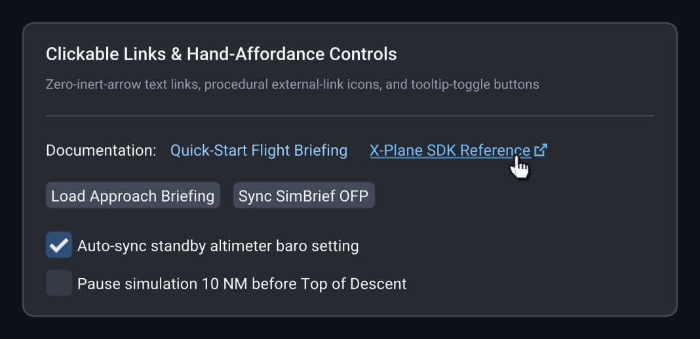

Stock Dear ImGui leaves interactive buttons, checkboxes, and clickable labels on an inert `Arrow` cursor. `imgui_clickable_links.h` supplies drop-in `*Link` wrappers (`ButtonLink`, `TextLink`, `CheckboxLink`, `RadioButtonLink`, `MenuItemLink`) that set `ImGuiMouseCursor_Hand` automatically and return `LinkClickResult` -- executing actions when tested inside `if (...)`, or toggling a trailing `TimedTooltip` ON/OFF when called as a standalone info link.

<br clear="all"/>

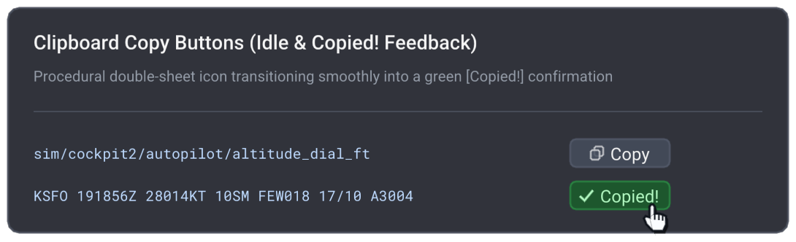

Alongside them, `imgui_copy_button.h` provides anti-twitch clipboard buttons (`CopyButton` for explicit buffers and `CopyLastItemButton` as an automatic chaser behind `InputText`) with procedural vector icons and `1.5s` transient `"Copied!"` confirmation.

<br clear="all"/>

```cpp
if (ImGui::ButtonLink("Save Route")) SaveRoute();
ImGui::TextLinkUnformatted("(i) Scroll-wheel tip");
ImGui::TimedTooltip::TextMD("Click any `(i)` label to toggle its help card immediately.");

ImGui::InputText("ICAO Route", s_RouteBuf, sizeof(s_RouteBuf));
ImGui::SameLine();
ImGui::CopyLastItemButton("##copy_icao_route");
```

---

### 10.9 Non-Blocking File Dialogs & Toolbar Pickers (`imgui_file_dialog.h`)

Native OS file dialogs block the main render thread, stall full-screen Vulkan/Metal/DX12 swapchains, and are invisible inside VR headsets. ImGee provides pure C++11, non-blocking, in-viewport file browsers using native POSIX (`opendir`/`readdir`) and Win32 (`FindFirstFileW`) APIs with zero shell/console spawning:

```cpp
// 1. Compact inline toolbar file switcher:
static std::string s_ActivePreset = "Default_Docking.json";
if (ImGui::FilePickerCombo("Preset", &s_ActivePreset, "Workspace_Presets", ".json;.ini")) {
    LoadPreset(s_ActivePreset);
}

// 2. Full in-window Open / Save modals (with breadcrumb bar, search filter & overwrite guard):
static bool s_ShowOpen = false;
static std::string s_ChosenPath;
if (ImGui::ButtonLink("Load Workspace Preset...")) s_ShowOpen = true;
if (ImGui::OpenFileDialog("Load Workspace Preset", &s_ShowOpen, &s_ChosenPath, "Workspace_Presets", ".json;.ini")) {
    LoadPreset(s_ChosenPath);
}
```

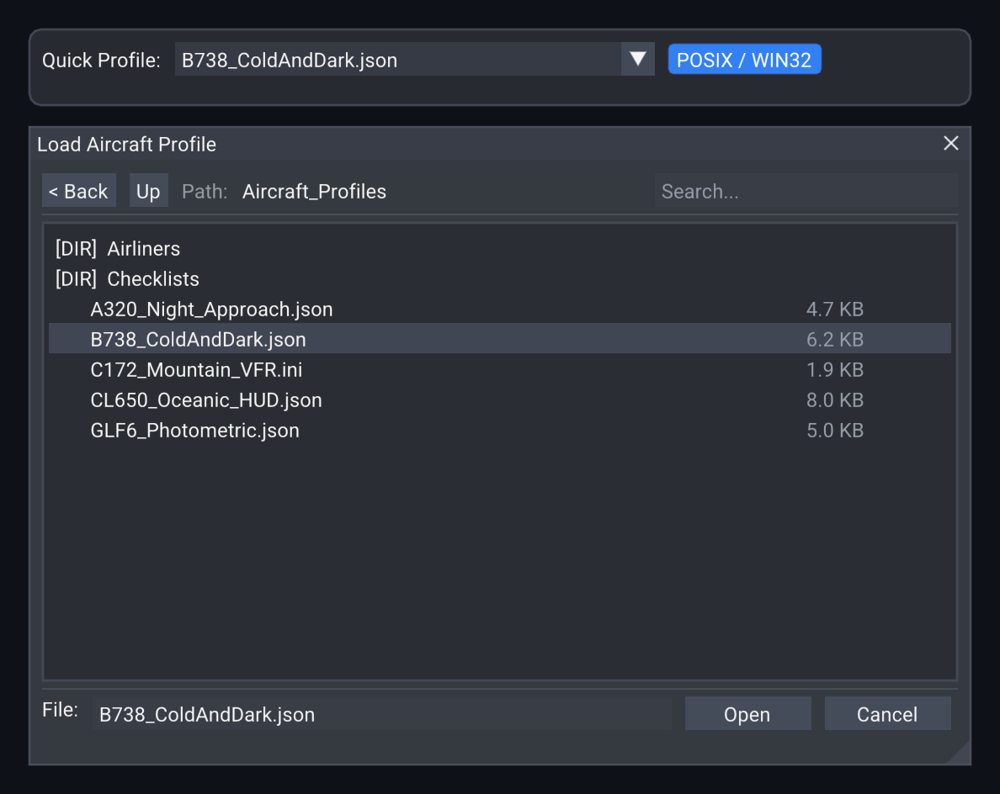

---

### 10.10 Curated Color Themes (`themes/imgui_styles.h`)

Stock `ImGui::StyleColorsDark()` uses a harsh 2015 electric-blue developer palette. ImGee includes refined, balanced palettes engineered for legible typography and comfortable long sessions:

```cpp
ImGui::ApplyDefaultTheme();     // Applies Charcoal Slate (canonical ImGee default)
ImGui::StyleColorsCharcoal();   // Understated studio graphite & cool platinum accents
ImGui::StyleColorsRusty();      // Warm low-glare bronze / terracotta with soft ivory text
ImGui::StyleColorsPaperLight(); // Crisp, high-contrast publication light theme
```

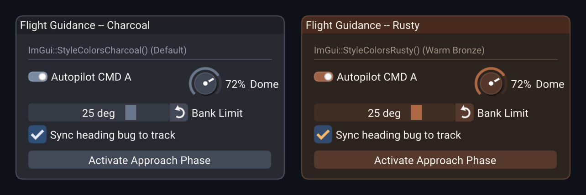

---

## Appendix A: Preprocessor Opt-Out Configuration & Build Matrix

> [!NOTE]
> **Zero-Overhead Opt-In Architecture:** Core `ImgWindow` never includes `ImGee` (or anything in `contrib/`). The `IMGEE_DISABLE_*` directives below are only needed when you include ImGee (`#include "imgee.h"`, `#include "ImGee/imgee.h"`, or `#include "ImgWindow/contrib/imgee.h"`) and wish to selectively exclude specific subsystems or widgets.

### A.1 Master Suite Toggle
| Preprocessor Define | Scope | Description |
| :--- | :--- | :--- |
| `IMGEE_DISABLE_ALL` | Suite | Excludes the entire ImGee suite when including `imgee.h` or umbrella headers. |

### A.2 Subsystem & Feature Opt-Outs
| Macro Directive | Description |
| :--- | :--- |
| `IMGEE_DISABLE_EXTENSIONS` | Excludes `Typography`, `Markdown`, `TimedTooltip`, `ZoomableViewport`, and `DocumentViewer`. |
| `IMGEE_DISABLE_WIDGETS` | Excludes all immediate-mode widgets in `widgets/`. |
| `IMGEE_DISABLE_THEMES` | Excludes `StyleColorsCharcoal` / `StyleColorsRusty` / `StyleColorsPaperLight` in `themes/`. |
| `IMGEE_DISABLE_TIMED_TOOLTIP` | Excludes stationary delayed tooltip engine. |
| `IMGEE_DISABLE_MARKDOWN` | Excludes Markdown parser, GFM tables, and callouts. |
| `IMGEE_DISABLE_TYPOGRAPHY` | Excludes `ImFontRole` and `ImGui::StyledText`. |
| `IMGEE_DISABLE_ZOOMABLE_VIEWPORT` | Excludes `ZoomableViewportState` and `BeginZoomedViewport` / `EndZoomedViewport`. |
| `IMGEE_DISABLE_DOC_VIEWER` | Excludes `DocumentViewer`, `DocumentViewerState`, and `ParseMarkdownToc`. |
| `IMGEE_DISABLE_ICONS` | Excludes procedural vector icon rendering engine. |
| `IMGEE_DISABLE_ICON_BUTTON` | Excludes `IconButton` and `ButtonIcon` push buttons. |
| `IMGEE_DISABLE_KNOBS` | Excludes rotary knobs, dimmer dials, and detents. |
| `IMGEE_DISABLE_MOUSE_WHEEL_CONTROLS` | Excludes wheel sliders, drags, combos, and reset buttons. |
| `IMGEE_DISABLE_BADGES` | Excludes status badges, pills, `PillNamed`, and keycaps. |
| `IMGEE_DISABLE_POPUP_MENUS` | Excludes directional anchored popups (`AboveItem`) and `SelectPulldown`. |
| `IMGEE_DISABLE_TOGGLE_BUTTONS` | Excludes animated physical toggle switches. |
| `IMGEE_DISABLE_CLICKABLE_LINKS` | Excludes OS hand cursor links (`ButtonLink`, `TextLink`). |
| `IMGEE_DISABLE_COPY_BUTTON` | Excludes `CopyButton` and `CopyLastItemButton`. |
| `IMGEE_DISABLE_FILE_DIALOG` | Excludes `FilePickerCombo`, `OpenFileDialog`, and `SaveFileDialog`. |
| `IMGEE_DISABLE_SPINNERS` | Excludes activity spinners and countdown timer dials. |
| `IMGEE_DISABLE_STB_IMAGE` | Disables ImGee's isolated built-in `stb_image` decoder. |
| `IMGEE_EXTERNAL_STB_IMAGE` | Optional compile-speed optimization: skips inline decoder compilation so you can compile `imgee_stb_image.cpp` once in large multi-TU projects. |
| `IMGEE_NO_IMGWINDOW_BRIDGE` | Disables automatic `ImgWindow.h` discovery and bridging even when `ImgWindow.h` is on `-I`. |
| `IMGEE_FILEPATHS_FORCE_RELATIVE` | Forces local Markdown image URLs to resolve strictly as relative paths (`1` by default with `ImgWindow`, `0` standalone). |
| `IMGEE_ENABLE_GLOBAL_NAMESPACES` | Publishes `Markdown::`, `MD::`, and `TimedTooltip::` to global scope. |

> [!NOTE]
> **Backward-Compatible Alias Bridge:** For projects written against earlier pre-v1.0 builds, legacy `CONTRIB_*` switches are automatically mapped to their canonical `IMGEE_*` counterparts with zero build warnings.

---
*Document Version: 1.1.1 • Author: Steven L. Goldberg (@slgoldberg) and the Rogers • ImGee Suite*
