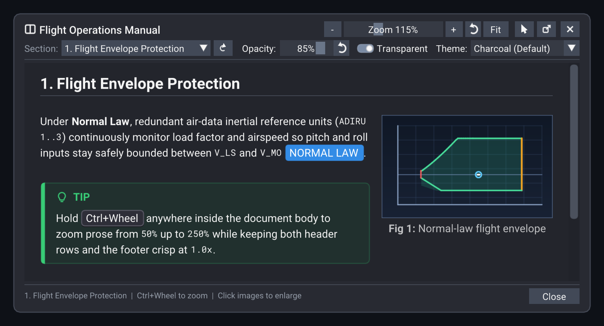

# Standalone DocumentViewer Extension

`extensions/DocViewer/imgui_doc_viewer.h` provides a self-contained, header-only Markdown manual and handbook viewer (`ImGui::DocumentViewer`) built on top of `BeginZoomedViewport` and `MarkdownExt`. It drops directly into any standalone Dear ImGui desktop tool, game engine, or flight-deck plugin with zero OS windowing or simulator SDK dependencies.



> **Author / Maintainer:** Steven L. Goldberg ([@slgoldberg](https://github.com/slgoldberg))  
> **License:** BSD 3-Clause (see [LICENSE](../../LICENSE))

---

## Quick Start

Include `imgee.h` (or `extensions/DocViewer/imgui_doc_viewer.h` directly), keep a `DocumentViewerState` instance alongside your window state, and pass your Markdown string each frame:

```cpp
#include "imgee.h"

static ImGui::DocumentViewerState s_ManualState;

void DrawOperationsManual(bool* p_open, const std::string& manualMarkdown) {
    if (!*p_open) return;

    if (ImGui::Begin("Operations Manual", p_open, ImGuiWindowFlags_NoScrollbar | ImGuiWindowFlags_NoScrollWithMouse)) {
        ImGui::DocumentViewerConfig cfg;
        cfg.title           = "Flight Operations Manual"; // Auto-detected from first '# H1' if left empty
        cfg.baseDir         = "Resources/plugins/my_plugin/docs";
        cfg.showCloseButton = true;

        if (!ImGui::DocumentViewer("##OpsManual", manualMarkdown, s_ManualState, &cfg)) {
            *p_open = false; // Closed via Row 1 [X] or optional footer Close button
        }
    }
    ImGui::End();
}
```

---

## How the Layout Works

Rather than scaling the entire `ImGuiWindow` (which bloats toolbar buttons and crowds narrow panels at high zoom), `DocumentViewer` splits the window into crisp `1.0x` outer chrome and an independently zoomed inner reading surface:

### 1. Row 1: Title & Content Zoom Bar (`1.0x`)
* **Responsive Document Title:** Renders on the left (using `cfg.title`, or automatically extracting the first `# H1` heading from the Markdown source) and elides cleanly before colliding with the right-hand controls.
* **Zoom Controls (`50% .. 250%`):** Right-aligned repeating `[-]` and `[+]` steppers, a mouse-wheel-enabled `Zoom %.0f%%` slider, and a 1-click A/B `ResetButton` (`↺` / `↻`) that swaps back and forth between `100%` and your last custom zoom factor.
* **Optional Host Window Hooks:** Cleanly hidden by default in standalone apps, and enabled selectively via `DocumentViewerConfig` flags and callbacks when hosted inside a simulator or multi-window shell (`[Fit]`, `[PDF]`, `[Cursor Toggle]`, `[Pop-Out / Pop-In]`, `[VR]`, `[X] Close`).

### 2. Row 2: Section Jump & Invariant HUD / Theme Controls (`1.0x`)
* **Automatic Table of Contents (`SelectPulldown`):** Scans `#`, `##`, and `###` ATX headings (ignoring ` ``` ` / `~~~` code fences and `>` blockquotes/callouts) into a compact section picker. Selecting any entry scrolls the zoomed viewport directly to that heading, and scrolling the document updates the active section readout automatically. An optional `[Reload]` icon button sits right beside the picker when `showReloadButton` or `onReloadRequested` is set.
* **Zero-Shift Opacity & Theme Strip:** Places `Opacity:` (or `Saturation:` when `isPoppedOut` is true) + `PercentSliderWithReset` (`10%..100%`, default `80%`) **to the left** of the `Transparent` / `Custom` `ToggleButton` and circular-wrapping `Theme:` `MouseWheelCombo` (`Charcoal (Default)`, `Rusty (Aviation)`, `ImGui Dark`, `ImGui Classic`, `ImGui Light`) so toggling translucent HUD mode never shifts the toggle switch or theme selector under the mouse cursor. Switching themes preserves your active `window_opacity`.

### 3. Zoomed Markdown Body (`Nx`) & Optional Footer (`1.0x`)
* **Independent Prose & Figure Zoom:** Renders inside `BeginZoomedViewport` (`Ctrl+MouseWheel`, plus `Cmd+MouseWheel` on macOS) via `MarkdownExt` with `baseDir` image resolution, click-to-enlarge same-context lightboxes (`enableImageLightbox = true`), text-wrapping image floats, GFM callouts, and sortable tables.
* **Internal `#heading-slug` Anchor Links:** Clicking `[Jump to Checklist](#approach-checklist)` scrolls directly to the matching heading inside the viewport, while external `http://` / `https://` links delegate to `cfg.externalLinkCallback` or `ImGui::OpenURL`.
* **Footer Chrome (`1.0x`):** Displays the current section breadcrumb or hint text on the left and an optional `Close` button on the right (`showFooter = true`, `showFooterCloseButton = false` by default).

---

## Key Types & Helpers

| Symbol | Purpose |
| :--- | :--- |
| `ImGui::DocumentViewerState` | Holds persistent viewer state: `viewport` (`ZoomableViewportState`), `window_opacity` (`0.80f`), `transparent_hud` (`true`), `theme_index`, `dynamic_cursors_enabled`, and cached `toc` entries. |
| `ImGui::DocumentViewerConfig` | Per-call options: `title`, `baseDir`, `externalPdfPath`, `maxTocHeadingLevel` (`3`), `tocWidth`, `showHeaderRow1`, `showHeaderRow2`, `showFooter`, optional `markdownConfig` override, and host window flags/callbacks. |
| `ImGui::ParseMarkdownToc(...)` | Standalone fence-aware ATX heading parser populating `std::vector<DocumentTocEntry>` with GitHub-compatible `#slug` anchors (including `-1`, `-2` duplicate suffixes). |
| `ImGui::JumpToDocumentAnchor(...)` | Programmatically scrolls `DocumentViewerState` to a `#heading-slug` anchor on the next frame. |
| `ImGui::JumpToDocumentHeading(...)` | Programmatically scrolls `DocumentViewerState` to a zero-based TOC heading index. |
| `ImGui::ApplyDocumentViewerTheme(...)` | Applies any of the 5 built-in `DocumentViewerTheme_` presets while preserving translucent `WindowBg` / `Border` alpha when `transparent_hud` is active. |

### Preprocessor Opt-Out
Define `#define IMGEE_DISABLE_DOC_VIEWER` before including `imgee.h` if you wish to exclude `imgui_doc_viewer.h` while keeping the rest of the extensions suite enabled.
