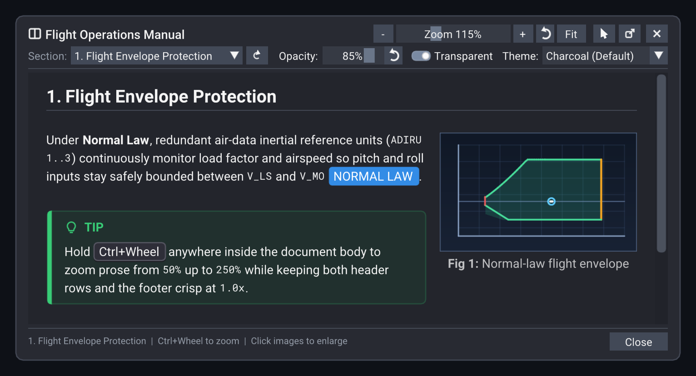

# ImGee Extensions Suite

This directory contains standalone, self-contained **Extensions** for Dear ImGui within the **ImGee** suite.

---

## What is an Extension?

In ImGee, an **Extension** is a subsystem providing stateful or structural capabilities beyond single immediate-mode controls. Extensions typically:
* Maintain frame-to-frame timing, scroll, or zoom state (`ImGuiContext`-isolated or caller-owned state structs).
* Accept optional configuration structs and callbacks.
* Encapsulate layout pre-calculation, CommonMark/GFM parsing, or semantic font resolution.

### Namespacing Philosophy: Omar Cornut's Standard & Sub-Namespaces

A common question from newcomers is: *"Why not invent a separate root namespace like `extgui::` or `eximgui::` to distinguish extension code?"*

The answer comes down to **Dear ImGui's ecosystem conventions**:

#### 1. Omar Cornut's Ecosystem Standard (Single Point of Discovery)
In official Dear ImGui extensions and ecosystem projects (such as `implot`, `imgui_club`, and `imnodes`), Omar Cornut advocates extending `namespace ImGui { ... }`.
* **Autocomplete & Discoverability:** When typing `ImGui::`, developers discover every capability available across their UI framework in one place.
* **Zero Cognitive Overhead:** Detached root namespaces force developers to memorize which feature lives where and juggle scattered `using namespace` declarations.

#### 2. Second-Level Sub-Namespaces
To keep the root `ImGui::` namespace free of collisions on common function names like `Text` or `Config`, multi-function subsystems encapsulate their APIs inside **second-level sub-namespaces** (`ImGui::<PackageName>::`):

```cpp
ImGui::Markdown::TextWrapped("Configure your **settings** below.");
ImGui::TimedTooltip::Text("Hover-delayed stationary tooltip.");
```

> [!TIP]
> **Forgiving Shorthands:**
> * **`ImGui::MD::`** is an official shorthand alias for **`ImGui::Markdown::`**.
> * Root shorthands such as **`ImGui::TextMD(...)`**, **`ImGui::ButtonMD(...)`**, **`ImGui::BeginZoomedViewport(...)`**, and **`ImGui::DocumentViewer(...)`** work directly under `ImGui::`.
> * Defining `#define IMGEE_ENABLE_GLOBAL_NAMESPACES` publishes `Markdown::`, `MD::`, and `TimedTooltip::` to the global scope.

---

## Current Extensions

| Extension | Directory | Primary Namespace / Entrypoint | Opt-Out Macro | Description |
| :--- | :--- | :--- | :--- | :--- |
| **TimedTooltip** | [`TimedTooltip/`](TimedTooltip/README.md) | `ImGui::TimedTooltip::` | `IMGEE_DISABLE_TIMED_TOOLTIP` | Stationary, dwell-delayed tooltip engine with bounding-box pre-calculation, screen-edge clamping, click-to-toggle support, and plain-text + Markdown bridges. |
| **Markdown** | [`Markdown/`](Markdown/README.md) | `ImGui::Markdown::` / `ImGui::MD::` | `IMGEE_DISABLE_MARKDOWN` | CommonMark + GFM tables with tristate sorting and drag-resizing, GFM callouts (`> [!NOTE]` .. `[!CAUTION]`), 3-tier images with text-wrapping floats and interactive zoom/pan lightboxes, inline styling tags, and `ButtonMD`. |
| **Typography** | [`Typography/`](Typography/README.md) | `ImGui::` (`ImFontRole`, `StyledText`) | `IMGEE_DISABLE_TYPOGRAPHY` | 9-slot semantic font role hierarchy (`ImFontRole`), RAII `ScopedFontRole` guards, and inline `StyledText` with continuous baseline alignment. |
| **Viewport** | [`Viewport/`](Viewport/README.md) | `ImGui::BeginZoomedViewport` | `IMGEE_DISABLE_ZOOMABLE_VIEWPORT` | Two-layer zoom container keeping outer window toolbars and footers sharp at `1.0x` while scaling scrollable inner content smoothly across `50%..250%`. |
| **DocViewer** | [`DocViewer/`](DocViewer/README.md) | `ImGui::DocumentViewer` | `IMGEE_DISABLE_DOC_VIEWER` | Turnkey standalone Markdown manual viewer with two-row `1.0x` header chrome, auto-parsed ATX TOC section jumper, 1-click scroll-to-top / return-to-spot (`↺`/`↻`), `#heading-slug` links, opacity slider, and 5-preset theme picker. |



---

## Authoring Guidelines for Extensions

When adding or extending an ImGee subsystem:

1. **Self-Contained Folder:** Place headers and documentation in `extensions/<ExtensionName>/`.
2. **Header-Only Entrypoint:** Provide a self-contained `.h` entrypoint with order-independent `#include` guards and `#pragma push_macro("min")` / `max` protection for MSVC `<windows.h>` compatibility.
3. **Context & Caller-Owned State:** Isolate ambient state per `ImGuiContext*` or accept an explicit caller-owned state struct (such as `ZoomableViewportState` or `DocumentViewerState`).
4. **Dear ImGui Version Range:** Guard version-specific internals with `#if defined(IMGUI_VERSION_NUM) && (IMGUI_VERSION_NUM >= ...)` so every header builds cleanly under `-Wall -Wextra -Werror -DIMGUI_DISABLE_OBSOLETE_FUNCTIONS` across Dear ImGui `v1.84.2` through `v1.92.8+`.
5. **Documentation:** Include a clear `README.md` with copy-pasteable C++ examples, configuration tables, and preprocessor opt-out flags.
