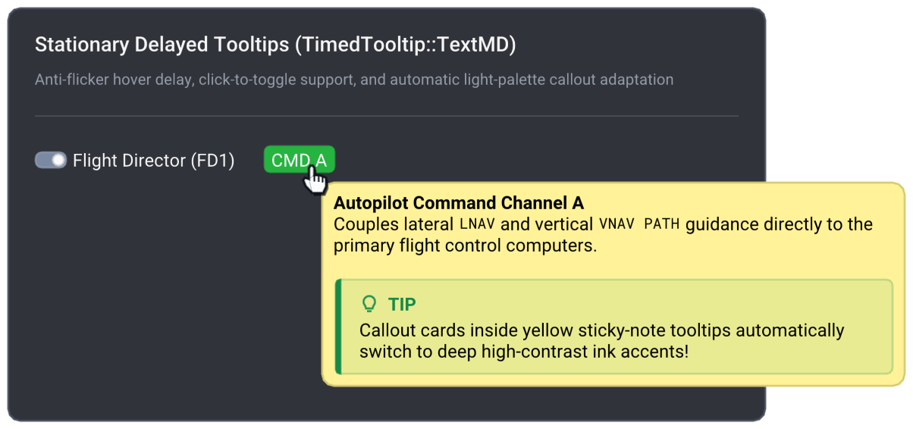

# TimedTooltip Extension

The **TimedTooltip** extension provides an advanced, stationary tooltip engine for Dear ImGui as part of the **ImGee** UI toolkit (designed for desktop applications, studio tools, game engines, and simulation hosts).

Unlike standard Dear ImGui tooltips which move with the mouse and can flicker, obstruct UI elements, or run off-screen, `TimedTooltip` locks in place, calculates dynamic viewport boundaries, preserves custom interactive cursors, isolates its styling hermetically from parent windows, and supports both plain-text and rich Markdown content.

> **Author / Maintainer:** Steven L. Goldberg ([@slgoldberg](https://github.com/slgoldberg))  
> **License:** BSD 3-Clause (see [LICENSE](../../LICENSE))

---

## Key Features



* **Configurable Delay & Lifetime:**
  * **Low Watermark (Hover Delay):** Prevents tooltip spam by waiting for the user to pause over a widget before showing.
  * **Active Input Low-Water Reset:** Spinning the mouse wheel (`io.MouseWheel` / `io.MouseWheelH`) or dragging (`IsMouseDragging`) over any widget immediately slams the hover timer back to 0 and dismisses any active tooltip, preventing tooltips from popping up or obstructing adjustments during continuous wheel scrolling or slider interaction.
  * **High Watermark (Auto-Dismiss):** Automatically hides tooltips after a readable duration, with adaptive time-scaling for taller/multi-line text.
  * **Grace Period:** Forgives micro-slips off the target widget so users don't lose their place.
  * **Wiggle Latch:** Micro-mouse movements reset the auto-hide timer so users can continue reading long descriptions.
* **Hermetic Style Isolation:**
  * Pushes and pops its own `WindowPadding`, `ItemSpacing`, `FramePadding`, and `IndentSpacing`. Outer parent window style modifications (such as `ItemSpacing.x = 0` in menu bars or compressed button pads) can never distort tooltip typography, and tooltip styles never leak back out.
  * Precise vertical line pitch (`item_spacing.y = 0.0f`) preserves native font leading across DPI scales, preventing vertical bloat and viewport overrun.
* **Smart Bounds Clamping & Docking:**
  * **Cursor-Safe Viewport Clamping (Flip Above Cursor):** If a tooltip would clip off the bottom of the screen (e.g. over a bottom control strip or footer slider), it automatically flips **above the mouse cursor**, ensuring the tooltip never covers the cursor or the widget being manipulated.
  * **Leftward Shift:** If a tooltip approaches the right screen border, it automatically shifts leftwards.
  * **Adaptive Wrap:** Shrink-wraps tightly around concise text while wrapping paragraphs at a readable width (80% of available viewport width by default).
* **Interactive Cursor Protection & Click-to-Toggle Ergonomics:**
  * Preserves and restores custom widget cursors (e.g., `ImGuiMouseCursor_Hand` or `ImGuiMouseCursor_ResizeEW`), and automatically shows a Hand cursor on passive text/labels that have a tooltip attached.
  * Clicking passive text, right-side Slider/Drag/Combo labels, dimmed at-default reset buttons, read-only indicator widgets, or standalone `*Link` widgets immediately toggles the tooltip ON/OFF without waiting for `hover_delay_cycles`.
* **Multi-`ImGuiContext` & Overlapping-Widget Safety:**
  * Isolates tooltip state and wheel-selection latches per `ImGuiContext*` so multi-window applications hosting independent `ImGuiContext` instances on the same frame never interfere with one another.
  * **Foreground-Widget Hover Priority:** When a button sits on the same line as a full-width background `Selectable(..., ImGuiSelectableFlags_SpanAllColumns)`, `TimedTooltip` automatically gives tooltip priority to the earlier foreground widget on the row without requiring manual hover-suppression flags.
* **Plain Text & Markdown Support (Order-Independent):**
  * Native auto-wrapping plain-text via `Text(...)`, single-line non-wrapping plain-text via `TextUnformatted(...)`, rich auto-wrapping Markdown via `TextMD(...)`, and single-line non-wrapping Markdown via `TextMDUnformatted(...)`.
  * `imgui_tooltip_ext.h` and `imgui_markdown_ext.h` can be `#include`d in **either order** and the `TextMD` / `TextMDUnformatted` bridge is synthesized automatically.

<br clear="all"/>

---

## Quick Start

### 1. Include the Header
```cpp
#include "imgee.h"
// (Or a-la-carte: #include "extensions/TimedTooltip/imgui_tooltip_ext.h", or via ImgWindow: #include "ImgWindow/contrib/imgee.h")
```

### 2. Basic Usage (Plain Text)
Attach a timed tooltip directly after drawing any ImGui widget:

```cpp
if (ImGui::Button("Export Preset")) {
    ExportPreset();
}
// Automatically attaches to the preceding widget:
ImGui::TimedTooltip::Text("Writes the active workspace configuration to disk as a .json file.");
```

### 3. Markdown Tooltips
If using the companion **Markdown** extension, simply call `TextMD`:

```cpp
#include "imgee.h"

ImGui::Button("Sync Timeline");
ImGui::TimedTooltip::TextMD("Locks **Frame Sync** to the master clock. *Requires an active transport source.*");
```

> [!TIP]
> **Forgiving Aliases:** Prefer explicit sub-namespaces? `ImGui::TimedTooltip::Markdown::Text(...)` and `ImGui::TimedTooltip::MD::Text(...)` work too! If you prefer flipping the order (`ImGui::Markdown::TimedTooltip::Text`), that works identically. For explicit click-to-toggle Markdown tooltips attached to a preceding item (such as an info label or passive status badge), use `TextMDLink(...)`.

---

## Configuration (`ImGui::TimedTooltip::Config`)

The `TooltipConfig` (aliased as `ImGui::TimedTooltip::Config`) controls timing, dimensions, typography, and colors.

### Configuration Fields Reference

| Field | Type | Default | Description |
| :--- | :--- | :--- | :--- |
| `hover_delay_cycles` | `int` | `25` | Frame cycles the mouse must hover before the tooltip appears (~0.4s at 60fps). |
| `max_display_cycles` | `int` | `504` | Frame cycles before the tooltip auto-dismisses. Set negative to disable auto-hide. |
| `grace_period_cycles`| `int` | `12` | Allowable frame cycles off the widget before cancelling hover state. |
| `size_skew_multiplier`| `float` | `0.5f` | Extra cycles added to display timeout per pixel of vertical height. |
| `enable_wiggle_latch`| `bool` | `true` | When `true`, subtle mouse movements inside the tooltip reset the dismiss timer. |
| `default_wrap_width` | `float` | `360.0f` | Target comfortable sticky-note width (~50-60 chars). Short text shrink-wraps tightly to its natural size. |
| `min_wrap_width`     | `float` | `240.0f` | Minimum width boundary before forced truncation/overflow. |
| `max_wrap_width`     | `float` | `600.0f` | Maximum width ceiling for wide documentation/manuals. |
| `padding`            | `ImVec2` | `(8.0f, 6.0f)` | Internal window padding around the tooltip contents. |
| `item_spacing`       | `ImVec2` | `(4.0f, 0.0f)` | Item spacing between lines. `y = 0.0f` matches native font leading. |
| `frame_padding`      | `ImVec2` | `(2.0f, 1.0f)` | Internal padding for frame elements inside the tooltip. |
| `indent_spacing`     | `float` | `20.0f` | Standard indent spacing between nested list levels. |
| `bullet_spacing`     | `float` | `4.0f` | **[Markdown Tooltips Only]** Gap in pixels between bullet glyph and following text when rendering rich lists via `TextMD`. (Ignored for plain-text tooltips.) |
| `font_scale_policy`  | `TooltipFontScalePolicy` | `TooltipFontScale_Damped` | Font-zoom scaling policy: `TooltipFontScale_Damped` (default damped curve with `0.90x` floor and `1.65x` ceiling), `TooltipFontScale_FixedChrome` (strict `1.0x`), or `TooltipFontScale_LinearInherit` (`1:1` parent scale). |
| `font_scale_multiplier` | `float` | `1.0f` | Relative multiplier applied on top of `font_scale_policy` (protected by a `0.75x` minimum legibility floor). |
| `font_scale`         | `float` | `0.0f` | Absolute font scale override (`0.0f` = use `font_scale_policy` + `font_scale_multiplier`; `>0.0f` = bypass policy curve, clamped to `[0.75f, 2.25f]`). |
| `font`               | `ImFont*` | `nullptr` | Optional explicit font for tooltip body text (`nullptr` resolves base UI `ImFontRole::Regular` / `io.FontDefault`). |
| `bg_color`           | `ImVec4` | Solid yellow | Window and popup background color (`#FFF299`, 100% opaque `alpha = 1.0f`). |
| `border_color`       | `ImVec4` | Dark yellow | Tooltip border outline color (`#CCBF66`). |
| `text_color`         | `ImVec4` | Jet black | Tooltip text and separator color (`#000000`). |

> [!NOTE]
> **Resolution-Independent Base Dimensions**:
> All dimensional settings (`default_wrap_width`, `min_wrap_width`, `max_wrap_width`, `padding`, `item_spacing`, `frame_padding`, and `indent_spacing`) are defined in **base design boxels** (at 1.0x baseline). The tooltip engine resolves the active ambient scale (`ImGui::GetFontSize() / 14.0f` or explicit `font_scale`) and automatically scales constraints and padding dynamically. Callers do not need to manually multiply configuration values by font zoom factors.

---

## Usage Patterns: Global Setup vs. Per-Call Overrides

### Pattern A: Global Setup (Once at Plugin Startup)
For 95% of use cases, configure your desired tooltip personality once during plugin startup or window creation:

```cpp
// In your plugin initialization:
static ImGui::TimedTooltip::Config s_MyTooltipConfig;
s_MyTooltipConfig.hover_delay_cycles = 45;                           // Snappier hover delay
s_MyTooltipConfig.padding            = ImVec2(8.0f, 6.0f);           // Compact padding
s_MyTooltipConfig.item_spacing       = ImVec2(4.0f, 0.0f);           // Tight line pitch
s_MyTooltipConfig.bg_color           = ImVec4(1.0f, 0.95f, 0.6f, 1.0f); // 100% opaque sticky note

ImGui::TimedTooltip::SetDefaultTooltipConfig(&s_MyTooltipConfig);
```

Every subsequent call to `ImGui::TimedTooltip::Text(...)` and `ImGui::TimedTooltip::TextMD(...)` will automatically use this configuration without needing any per-call arguments.

### Pattern B: Per-Call Override (Instant & Dynamic)
If a specific widget needs unique styling -- for example, a wider maximum width, distinct background color, or custom padding -- you can fetch a copy of the active configuration using `ImGui::TimedTooltip::GetConfig()`, tweak the desired fields, and pass it directly to `Text` or `TextMD`:

```cpp
// Safely copies the active global config (or built-in defaults if no global config was set):
ImGui::TimedTooltip::Config wideConfig = ImGui::TimedTooltip::GetConfig();
wideConfig.max_wrap_width = 800.0f;                       // Allow wider manual formatting
wideConfig.bg_color       = ImVec4(0.15f, 0.15f, 0.20f, 0.95f); // Dark HUD styling
wideConfig.text_color     = ImVec4(1.0f, 1.0f, 1.0f, 1.0f);

ImGui::Button("System Diagnostics");
// Pass custom configuration directly:
ImGui::TimedTooltip::TextMD(&wideConfig, "### System Status\n* Bus 1: **Normal**\n* Bus 2: **Normal**");
```

### Pattern C: Low-Level Custom Layout Blocks
For completely custom tooltip content containing arbitrary ImGui widgets, use `BeginStationaryTooltip` and `EndStationaryTooltip` (matching stock `ImGui::EndTooltip()`, the zero-arg `EndStationaryTooltip()` closes the active tooltip automatically; the `const char*` and `ImGuiID` overloads remain supported as well):

```cpp
ImGui::Button("Engine Monitor");
if (ImGui::TimedTooltip::BeginStationaryTooltip("EngineMonitorTooltip")) {
    ImGui::Text("EGT: 640 C");
    ImGui::ProgressBar(0.75f, ImVec2(150, 15));
    ImGui::TimedTooltip::EndStationaryTooltip();
}
```

---

## Hermetic Style Isolation

In Dear ImGui, child windows and popups can inadvertently inherit active layout styles from their parent windows. If an outer menu bar or custom toolbar has set `ItemSpacing.x = 0.0f` or compressed `FramePadding` to pack buttons tightly, standard tooltips would inherit those distorted spacing values.

`TimedTooltip` isolates itself completely:
1. When opening a tooltip proxy, `BeginStationaryTooltipProxy` pushes:
   * `ImGuiStyleVar_WindowPadding` (`config->padding`)
   * `ImGuiStyleVar_ItemSpacing` (`config->item_spacing`)
   * `ImGuiStyleVar_FramePadding` (`config->frame_padding`)
   * `ImGuiStyleVar_IndentSpacing` (`config->indent_spacing`)
2. When closing, `EndStationaryTooltip` pops all four style variables in exact reverse order.

This guarantees that:
* **No outer window hacks leak inward:** Tooltips always render with crisp, predictable typography regardless of what the calling window modified.
* **No tooltip styles leak outward:** Calling windows retain their exact style state without needing defensive push/pop blocks.

---

## Screen Clamping & Docking

Tooltips automatically check the active display dimensions (`ImGui::GetIO().DisplaySize`):
* **Bottom Edge Protection:** If `render_pos.y + height` exceeds the screen floor, the anchor position automatically shifts upward so the entire tooltip remains visible on screen.
* **Right Edge Protection:** If `render_pos.x + width` exceeds the screen edge, the tooltip shifts leftwards to keep all content in view.

---

## Click Forwarding & Automatic Dismissal

Tooltips attached to interactive or proxy-instrumented widgets (like `ButtonLink`, chevron menus, or `TextProxy` / `TextMDProxy` items) automatically intercept clicks via `ImGui::IsItemClicked()`:
* **Immediate Dismissal:** Clicking an active widget immediately dismisses the active tooltip, preventing tooltips from lingering over open menus or blocking post-click interactions.
* **Toggle on Idle Click:** Clicking an idle/non-actionable widget (such as a dimmed reset button or standalone info link) cleanly toggles the explanation tooltip on/off.

---

## GPU Linear Color-Space Blending & Font Scaling

### 1. 100% Solid Opacity (`alpha = 1.0f`)
In legacy sRGB-unaware OpenGL backends, UI overlays composited in uncorrected gamma space, where semi-transparent yellow cards (`alpha = 0.95f`) appeared nearly solid.

In modern **physically linear GPU compositing** pipelines (Metal, Vulkan, DirectX 12 sRGB framebuffers, HDR viewports, and simulation renderers), blending is computed in linear light. Even a minor 5% transparency allows bright 3D geometry, highlights, or high-contrast canvas elements behind the card to bleed into pixels under dark text -- and linear antialiasing blends 50% edge coverage at ~73% background luminance (`0.5^(1/2.2) ~ 0.73`), optically thinning dark letter stems.

To ensure crisp, high-contrast dark typography without background wash-out across both gamma and linear renderers, `TooltipConfig::bg_color` defaults to **`1.0f` solid opacity** (`ImVec4(1.0f, 0.95f, 0.6f, 1.0f)`).

### 2. Damped Ambient Font Scale Inheritance & Base-Font Isolation
When `TooltipConfig::font_scale` is left at `0.0f` (the default), the tooltip engine evaluates the calling window's ambient font scale through `TooltipConfig::font_scale_policy` while isolating the tooltip's base font against transient caller `PushFont(...)` scopes:
* **Base-Font Isolation (`TooltipConfig::font == nullptr`):** Resolves `ImGui::GetFont(ImFontRole::Regular)` via an order-independent `TimedTooltip <-> Typography` bridge (falling back to `io.FontDefault`, then `io.Fonts->Fonts[0]` when `io.FontDefault` is null) for both dry-run `perfect_size` pre-measurement and tooltip window rendering. Calling `TimedTooltip::Text` or `TextMD` inside a compact toolbar's `PushFont(...)` block keeps body text aligned with 14px inline bold, italic, and monospace spans.
* **Damped Default Curve (`TooltipFontScale_Damped`):** Gently compresses zoomed-out windows down to a protective `0.90x` floor (preventing unreadable microprint) and ramps zoomed-in windows sub-linearly (`slope = 0.55`) up to a `1.65x` ceiling so tooltips stay comfortable without turning into screen-filling slabs at `250%` document zoom. Switch `font_scale_policy` (or `SetDefaultFontScalePolicy(...)`) to `TooltipFontScale_FixedChrome` for strict `1.0x` tooltips or `TooltipFontScale_LinearInherit` for `1:1` parent coupling.
* **Pre-Calculation Accuracy:** Both `TextProxyV` and the 2-pass Markdown size pre-calculator (`MD::CalcMarkdownSize`) measure wrap boundaries and vertical heights using the isolated base font and effective scale factor, guaranteeing zero text clipping and zero scrollbar flutter on Frame 1.

---

## API Summary

```cpp
namespace ImGui {
    namespace TimedTooltip {
        // High-level Plain Text (auto-wraps to TooltipConfig bounds; returns true when displayed):
        bool Text(const char* fmt, ...);
        bool Text(const TooltipConfig* config, const char* fmt, ...);
        bool Text(const std::string& text, const TooltipConfig* config = nullptr);

        // Single-line / Non-Wrapping Plain Text (never wraps unless '\n' is present):
        bool TextUnformatted(const char* text, const TooltipConfig* config = nullptr);
        bool TextUnformatted(const std::string& text, const TooltipConfig* config = nullptr);

        // High-level Plain Text Proxy (explicit ID and hover state):
        bool TextProxy(ImGuiID id, bool is_hovered, const char* fmt, ...);
        bool TextProxy(ImGuiID id, bool is_hovered, const TooltipConfig* config, const char* fmt, ...);
        bool TextProxy(ImGuiID id, bool is_hovered, const std::string& text, const TooltipConfig* config = nullptr);
        bool TextProxy(const char* str_id, bool is_hovered, const char* fmt, ...);
        bool TextProxy(const char* str_id, bool is_hovered, const std::string& text, const TooltipConfig* config = nullptr);

        // High-level Markdown (requires imgui_markdown_ext.h in either include order; returns true when displayed):
        bool TextMD(const char* fmt, ...);
        bool TextMD(const TooltipConfig* config, const char* fmt, ...);
        bool TextMD(const std::string& markdown_text, const TooltipConfig* config = nullptr);

        // Explicit Click-to-Toggle Markdown Tooltip Chaser (attaches toggle-on-click to preceding item):
        bool TextMDLink(const char* fmt, ...);
        bool TextMDLink(const TooltipConfig* config, const char* fmt, ...);
        bool TextMDLink(const std::string& markdown_text, const TooltipConfig* config = nullptr);

        // Single-line / Non-Wrapping Markdown (never auto-wraps; single line per '\n'):
        bool TextMDUnformatted(const char* markdown_text, const TooltipConfig* config = nullptr);
        bool TextMDUnformatted(const std::string& markdown_text, const TooltipConfig* config = nullptr);

        // High-level Markdown Proxy (explicit ID and hover state):
        bool TextMDProxy(ImGuiID id, bool is_hovered, const char* fmt, ...);
        bool TextMDProxy(ImGuiID id, bool is_hovered, const TooltipConfig* config, const char* fmt, ...);
        bool TextMDProxy(const char* str_id, bool is_hovered, const char* fmt, ...);
        bool TextMDProxy(ImGuiID id, bool is_hovered, const std::string& markdown_text, const TooltipConfig* config = nullptr);
        bool TextMDProxy(const char* str_id, bool is_hovered, const std::string& markdown_text, const TooltipConfig* config = nullptr);

        // Explicitly opt the preceding widget into click-to-toggle tooltip behavior for the current frame:
        void ToggleOnClick(bool enable = true);

        // Configuration:
        using Config = TooltipConfig;
        using State  = TooltipState;
        void SetDefaultTooltipConfig(const Config* config);
        const Config*& GetDefaultTooltipConfig();
        const Config& GetCurrentTooltipConfig();
        Config GetConfig();

        // Low-level lifecycle controls:
        bool BeginStationaryTooltipProxy(ImGuiID id, bool is_hovered, const Config* cfg = nullptr);
        bool BeginStationaryTooltip(ImGuiID id, const Config* cfg = nullptr);
        bool BeginStationaryTooltip(const char* str_id, const Config* cfg = nullptr);
        void EndStationaryTooltip();
        void EndStationaryTooltip(ImGuiID id);
        void EndStationaryTooltip(const char* str_id);
        void ClearActiveTooltip();
    }
}
```
