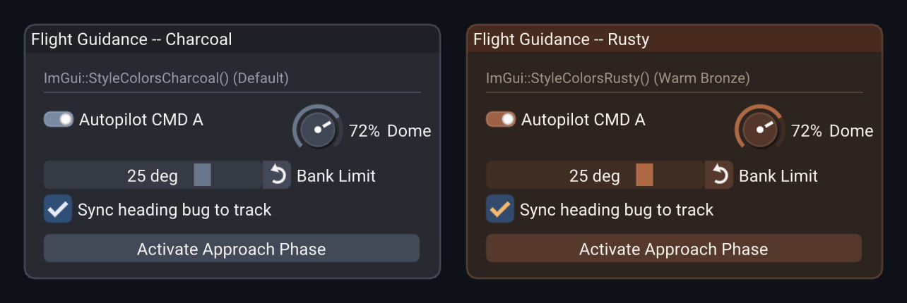

# Curated Studio & Cockpit Themes

`themes/imgui_styles.h` replaces Dear ImGui's harsh 2015 electric-blue developer palette (`ImGui::StyleColorsDark()`) with balanced, low-fatigue color themes tuned for legible typography, crisp control borders, and night-cockpit ergonomics.



> **Author / Maintainer:** Steven L. Goldberg ([@slgoldberg](https://github.com/slgoldberg))  
> **License:** BSD 3-Clause (see [LICENSE](../LICENSE))

---

## Available Palettes

1. **Charcoal Slate (`ImGui::StyleColorsCharcoal` / `ImGui::ApplyDefaultTheme`):**
   * ImGee's canonical default palette. Pairs deep graphite window surfaces with cool platinum/slate interactive frames, subtle 1px borders, and calm steel-blue active highlights so colored status `<badge>`s, `<pill>`s, and GFM callouts stand out cleanly without clashing against neon window chrome.
2. **Rusty Aviation Bronze (`ImGui::StyleColorsRusty`):**
   * Warm bronze, espresso, and terracotta tones with soft ivory text -- designed for night flying and low-glare cockpit utilities where cool blue light feels harsh against a dark flight deck.

---

## Quick Start

Call any theme function once during ImGui context initialization (or dynamically at runtime when switching themes):

```cpp
#include "imgee.h"
// (Or standalone: #include "themes/imgui_styles.h")

// Apply ImGee's canonical Charcoal Slate palette to the active context:
ImGui::ApplyDefaultTheme();

// Or switch palettes explicitly (pass an optional ImGuiStyle* to populate a separate style struct):
ImGui::StyleColorsCharcoal();
ImGui::StyleColorsRusty();
```

### Preprocessor Opt-Out
Define `#define IMGEE_DISABLE_THEMES` before including `imgee.h` if your host application manages all `ImGuiStyle` colors exclusively on its own.
