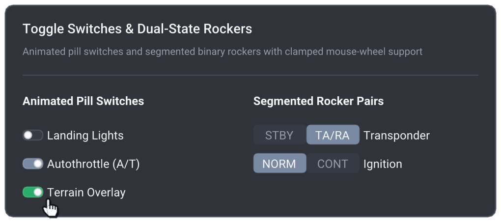
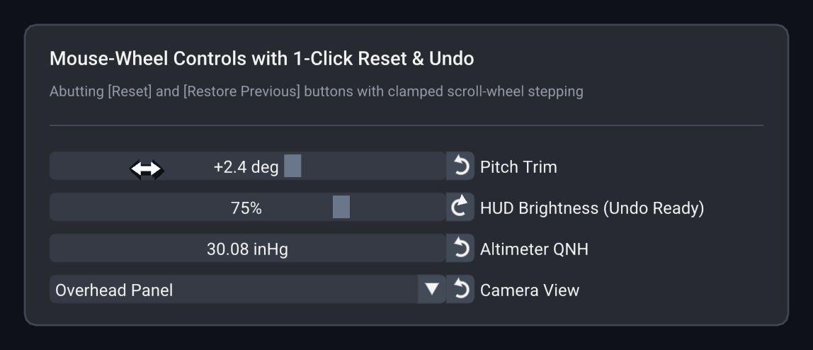
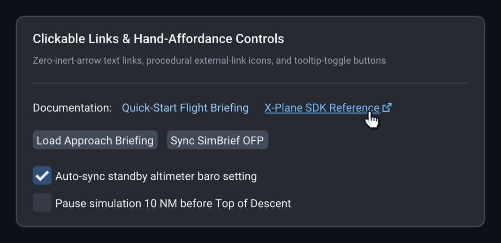
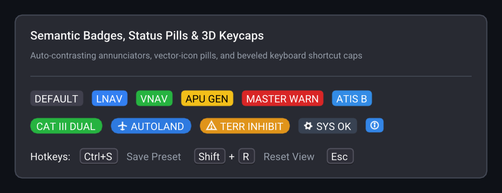
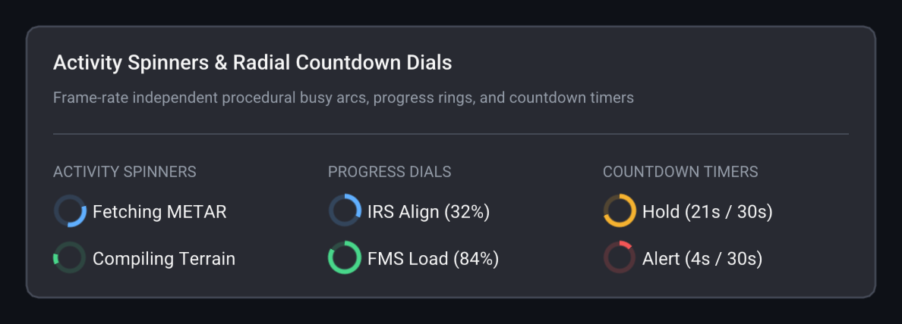
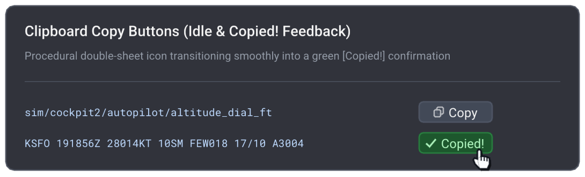
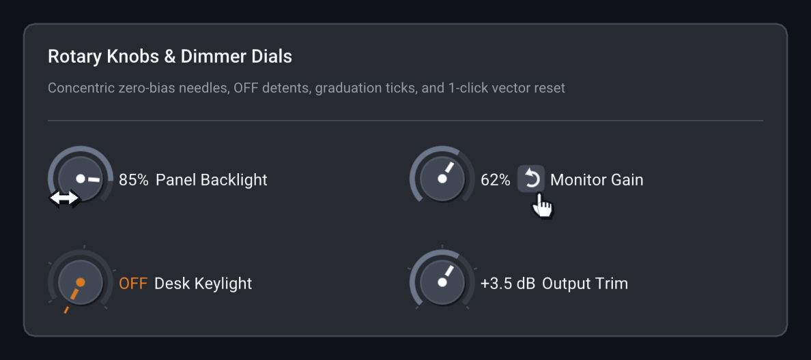
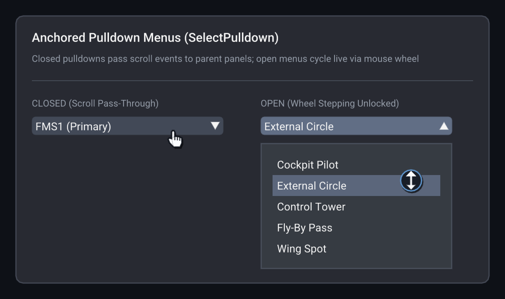
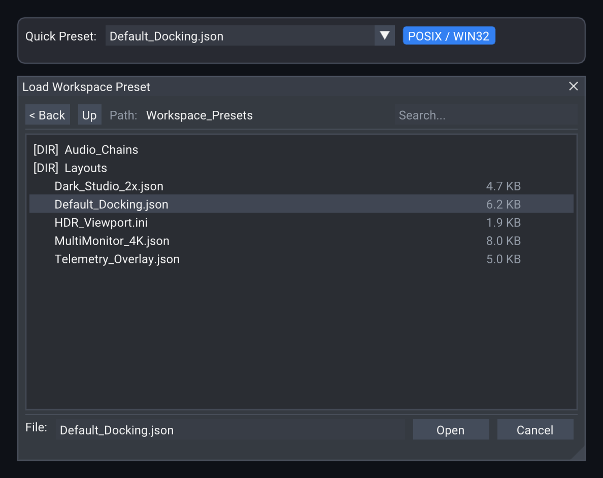
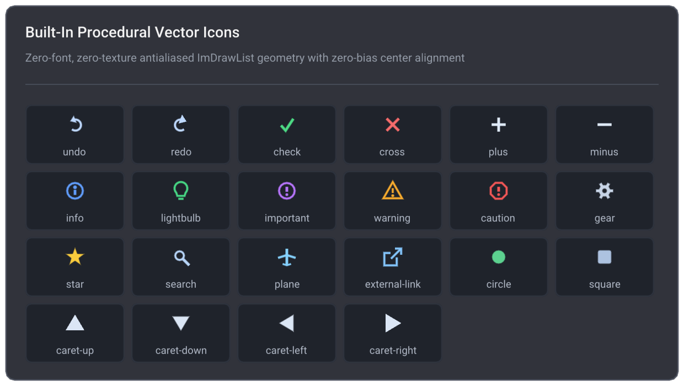

# ImGee Immediate-Mode UI Widgets

This directory contains lightweight, reusable, immediate-mode **Widgets** extending Dear ImGui as part of the **ImGee** UI toolkit.

Unlike **Extensions** (which manage stateful subsystems, syntax parsers, or font registries), **Widgets** are self-contained immediate-mode controls. They hook directly into Dear ImGui's ambient context (`GImGui`, ID stack, `ImGuiStorage`, and window draw lists) and live in the root `ImGui::` namespace so they read just like built-in controls.

---

## Architecture & Inclusion Strategy

### 1. Root `ImGui::` Namespacing
All widgets in this directory live directly inside `namespace ImGui { ... }`. You call `ImGui::Knob(...)`, `ImGui::ToggleButton(...)`, `ImGui::SliderWithReset(...)`, `ImGui::Badge(...)`, `ImGui::Icon(...)`, and `ImGui::SelectPulldown(...)` alongside standard `ImGui::Checkbox` or `ImGui::SliderFloat`.

### 2. Inclusion Models

| Pattern | Usage | Benefit |
| :--- | :--- | :--- |
| **Master ImGee Suite (Recommended)** | `#include "imgee.h"` *(or `"ImgWindow/contrib/imgee.h"` via ImgWindow)* | Includes **all** ImGee extensions (`TimedTooltip`, `Markdown`, `Typography`, `Viewport`, `DocViewer`), themes, and widgets in one line. |
| **ImGee Widgets Roll-Up** | `#include "widgets.h"` *(or `"ImGee/widgets.h"`)* | Instant access to the entire widget collection in one line. |
| **A-la-Carte Widget** | `#include "widgets/imgui_knobs.h"` *(or `"ImGee/widgets/imgui_knobs.h"`)* | Include only the specific control family you need, in any include order. |

#### Opt-Out Configuration Flags
Define any of the following `IMGEE_*` macros *before* including `imgee.h` if you want to exclude individual widget families (pre-v1.0 `CONTRIB_*` defines remain mapped automatically):

```cpp
#define IMGEE_DISABLE_WIDGETS                 // Disables all ImGee widgets
#define IMGEE_DISABLE_KNOBS                   // Disables rotary knobs, dimmer dials & detents
#define IMGEE_DISABLE_MOUSE_WHEEL_CONTROLS    // Disables wheel sliders, drags, cyclers & combos
#define IMGEE_DISABLE_TOGGLE_BUTTONS          // Disables ToggleButton & ToggleButtons
#define IMGEE_DISABLE_BADGES                  // Disables Badge, Pill, PillNamed & Kbd widgets
#define IMGEE_DISABLE_POPUP_MENUS             // Disables SelectPulldown, OpenPopupAtItem & BeginAnchoredPopup
#define IMGEE_DISABLE_ICONS                   // Disables procedural vector icon engine & ImGui::Icon
#define IMGEE_DISABLE_ICON_BUTTON             // Disables IconButton & ButtonIcon push buttons
#define IMGEE_DISABLE_CLICKABLE_LINKS         // Disables ButtonLink, TextLink & AttachItemCursor
#define IMGEE_DISABLE_SPINNERS                // Disables Spinner, RadialTimer & CountdownTimer
#define IMGEE_DISABLE_COPY_BUTTON             // Disables CopyButton & CopyLastItemButton
#define IMGEE_DISABLE_FILE_DIALOG             // Disables FilePickerCombo, OpenFileDialog & SaveFileDialog
```

---

## Widget Catalog

### 1. Toggle Controls (`imgui_toggle_buttons.h`)



#### A. Animated Toggle Switch (`ImGui::ToggleButton`)
A rounded pill switch with a smooth `io.DeltaTime`-driven thumb animation stored per widget ID in `ImGuiStorage`. Accepts `bool*`, `int*`, `bool&`, or `int&` (`0` = Off, non-zero = On).

* **Clamped Mouse-Wheel Support:** Rolling the scroll wheel up/right over the pill track turns it **On** and clamps there; rolling down/left turns it **Off** and clamps there. Hovering the text label ignores the wheel so parent panels scroll freely.
* **Per-State Tooltips & DPI Scaling:** Accepts optional `(off_tooltip, on_tooltip)` strings (or a 2-element array) routed through `TimedTooltip`, scales automatically with ambient font size, and shows `ImGuiMouseCursor_Hand` on hover.

<br clear="all"/>

```cpp
static bool s_ExpertMode = false;
static bool s_HudActive  = true;

// 1. Standard switch with clickable right-side label:
ImGui::ToggleButton("Expert Mode", &s_ExpertMode);

// 2. Per-state Markdown tooltips (Off tooltip, On tooltip):
ImGui::ToggleButton("HUD Overlay", &s_HudActive,
                    "HUD is **OFF**. Click or scroll up to enable.",
                    "HUD is **ON**. Click or scroll down to disable.");

// Optional global active-track tint:
ImGui::SetDefaultToggleButtonColors(IM_COL32(66, 150, 250, 255));
```

#### B. Segmented Dual-Button Pair (`ImGui::ToggleButtons`)
Joined side-by-side buttons for explicit two-way mode choices (`Solid Opaque` / `Glass Translucent`). Supports an optional clickable right-side title (`"Surface Style##style_pair"`), clamped mouse-wheel toggling, and wheel-selection tooltip latching (`out_hovered_item`) when spinning the wheel over a stationary cursor.

```cpp
static int s_WindowStyle = 0; // 0 = Solid Opaque, 1 = Glass Translucent
if (ImGui::ToggleButtons("Surface Style##style_pair", &s_WindowStyle, "Solid Opaque", "Glass Translucent")) {
    ApplyStyleChange(s_WindowStyle);
}
```

---

### 2. Mouse-Wheel Sliders, Drag Boxes, Cyclers & Combos (`imgui_mouse_wheel_controls.h`)

#### A. Chasers for Stock ImGui Controls (`AdjustItemOnMouseWheel` / `CycleItemOnMouseWheel`)
Attach mouse-wheel stepping to any preceding Dear ImGui slider, drag box, button, or combo. `AdjustItemOnMouseWheel` shows `ResizeEW` strictly over the physical control track (never over the text label), while `CycleItemOnMouseWheel` steps discrete indices (`wrap = false` by default):

```cpp
ImGui::SliderFloat("Text Zoom", &fontZoom, 0.75f, 1.75f);
ImGui::AdjustItemOnMouseWheel(&fontZoom, 0.75f, 1.75f, 0.01f);

if (ImGui::ButtonLink(kDensityLabels[s_DensityIdx])) {
    ImGui::OpenPopup("##density_menu");
}
ImGui::CycleItemOnMouseWheel(&s_DensityIdx, 5 /* count */, false /* wrap */);
```

#### B. Turnkey Sliders, Drag Boxes & Reset-with-Undo (`SliderWithReset` / `PercentSliderWithReset` / `DragWithReset`)
Drop-in replacements overloaded for both `float*` and `int*` (`MouseWheelSlider`, `PercentSlider`, `MouseWheelDrag`), plus compound `*WithReset` variants with a flush abutting vector reset/undo button (`0`-gap shared frame border):

* **1-Click A/B Comparison ("Reset with Undo"):** When modified (`*v != v_default`), clicking `↺` saves your custom value into per-ID session memory (or an optional `float* v_last` pointer), resets `*v = v_default`, and flips the glyph to **`↻`**. Clicking **`↻`** swaps right back to your custom setting so you can A/B test changes in one click.
* **Automatic 3-State Tooltips:** Formats `"Click to revert to default (85%)."`, `"At default (85%). Click to restore previous (42%)."`, and `"Already at default (85%)."` automatically from your `format` string.

```cpp
static float s_Heading = 215.0f;
static float s_Opacity = 0.85f;
static float s_Pitch   = -1.5f;

ImGui::SliderWithReset("Heading",      &s_Heading, 180.0f /* default */, 0.0f, 360.0f, "%.0f°");
ImGui::PercentSliderWithReset("Alpha", &s_Opacity, 0.80f  /* default */, 0.1f, 1.0f);
ImGui::DragWithReset("Pitch Trim",     &s_Pitch,   0.0f   /* default */, 0.1f, -15.0f, 15.0f, "%+.1f°");
```



#### C. Turnkey Mouse-Wheel Combos & Checkboxes (`MouseWheelCombo` / `ComboWithReset` / `MouseWheelCheckbox`)
* **Split Preview vs. Chevron Zones:** In `MouseWheelCombo` and `ComboWithReset`, hovering the preview field shows `ResizeNS` and cycles items on wheel scroll, while hovering the right-hand `[▼]` chevron shows `Hand` and acts strictly as the popup opener. Inside the open dropdown, spinning the wheel latches per-item `TimedTooltip`s to `*current_item` ("Lens UI") until the mouse moves deliberately (`> 6 px`).
* **Track-Only Wheel Checkboxes:** `MouseWheelCheckbox` (and `ToggleItemOnMouseWheel`) responds to wheel scrolling strictly over the square `[✓]` box while leaving the clickable text label scroll-safe.
* **Scrollable Viewport Auto-Defeat:** All wheel controls inspect parent windows for active vertical scrolling (`ScrollMax.y > 0.0f`) and automatically pass wheel events through to window scrolling unless `bAllowMouseWheelOnScrollable = true` is requested.

```cpp
static const char* const kCamModes[] = { "Cockpit", "Chase", "Circle", "Tower" };
static int  s_CamMode  = 1;
static bool s_AutoZoom = true;

ImGui::ComboWithReset("Camera Mode", &s_CamMode, 1 /* default */, kCamModes, IM_ARRAYSIZE(kCamModes));
ImGui::MouseWheelCheckbox("Enable Auto-Zoom", &s_AutoZoom);
```

---

### 3. Clickable Link & Item Cursor Affordances (`imgui_clickable_links.h`)



Stock Dear ImGui leaves buttons, checkboxes, menu items, and clickable labels on the default OS `Arrow` cursor. `imgui_clickable_links.h` provides zero-boilerplate `*Link` wrappers (`ButtonLink`, `TextLink`, `CheckboxLink`, `RadioButtonLink`, `SelectableLink`, `MenuItemLink`) plus `AttachItemCursor()`.

* **Ambient Color Preservation:** Unlike Dear ImGui 1.91+'s sky-blue underlined `TextLink`, `ImGui::TextLink` preserves your ambient `ImGuiCol_Text` color by default (with Dear ImGui's hyperlink preserved as `ImGui::NativeTextLink`).
* **Smart Click-to-Toggle Tooltips (`LinkClickResult`):** Testing `if (ImGui::ButtonLink("Save"))` marks the click handled and dismisses any open tooltip; calling `ImGui::TextLink("(i) Help");` as a standalone statement leaves the click unconsumed so clicking toggles a trailing `TimedTooltip` ON and OFF immediately.

<br clear="all"/>

```cpp
// 1. Action button (tested in `if` -> runs action and dismisses tooltip on click):
if (ImGui::ButtonLink("Save Flight Plan")) {
    SavePlan();
}
ImGui::TimedTooltip::TextMD("Saves the active flight plan to disk.");

// 2. Standalone info link (return value ignored -> clicking toggles tooltip ON/OFF):
ImGui::TextLinkUnformatted("(i) Scroll-wheel shortcut");
ImGui::TimedTooltip::TextMD("Spin the **mouse wheel** over an open menu to step through items.");

// 3. Form controls and arbitrary items with active cursor cues:
ImGui::CheckboxLink("Enable Autothrottle", &s_Autothrottle);
ImGui::RadioButtonLink("NAV 1", &s_NavSource, 1);
```

---

### 4. Badges, Pills & Key Caps (`imgui_badges.h`)



Standalone immediate-mode status capsules, annunciators, and 3D keyboard shortcut chips -- usable directly in C++ panels with zero Markdown parsing overhead (and also backing Markdown's `<badge>`, `<pill>`, and `<kbd>` tags):

* **Baseline-Centered Geometry:** Aligns capsule padding against TrueType `Ascent`/`Descent` so descenders (`p`, `g`, `y`) never clip or sag.
* **Automatic ITU-R BT.601 Contrast:** Picks crisp dark or white foreground text automatically from background luminance whenever foreground color is omitted.
* **Tactile Keycaps (`ImGui::Kbd`):** Draws rounded key borders with a subtle bottom bevel shadow.

<br clear="all"/>

```cpp
ImGui::Badge("ONLINE", ImGui::ImGuiBadgeVariant_Success);
ImGui::SameLine();
ImGui::Badge("FAULT",  ImGui::ImGuiBadgeVariant_Danger);
ImGui::SameLine();
ImGui::Pill("v1.1",    ImGui::ImGuiBadgeVariant_Primary);

ImGui::TextUnformatted("Toggle Autopilot:");
ImGui::SameLine();
ImGui::Kbd("Ctrl+Shift+Z");
```

---

### 5. Procedural Spinners & Countdown Dials (`imgui_spinners.h`)



Antialiased `ImDrawList` activity indicators, progress rings, and radial countdown timers with zero texture assets and zero heap allocations.

* **Breathing Arc Spinners (`ImGui::Spinner`):** Sinusoidal sweep expansion/contraction scaled automatically to `ImGui::GetFontSize()` when `radius == 0.0f`.
* **12-O'Clock Radial Timers (`RadialTimer` / `CountdownTimer`):** Sweeps cleanly from `-90°` over a subtle track ring, supporting click-to-toggle `TimedTooltip` explanations on hover and click.

<br clear="all"/>

```cpp
ImGui::Spinner("Syncing airport navdata...");

float remainingFrac = 0.65f;
ImGui::RadialTimer("Auto-dismiss", remainingFrac);

ImGui::CountdownTimer("Approach Fix", 3.2f /* seconds left */, 10.0f /* total */);
```

---

### 6. Standalone & Chaser Copy Buttons (`imgui_copy_button.h`)



Immediate-mode clipboard buttons with procedural vector clipboard/checkmark icons, `1.5s` transient `"Copied!"` confirmation, and anti-twitch bounding width (`max("Copy", "Copied!")`) so neighboring toolbar items never jump.

* **Standalone Buffer Mode (`CopyButton` / `CopyBufferButton`):** Copies any `const char*` or `std::string` payload directly.
* **Zero-Redundancy Input Chaser (`CopyLastItemButton` / `CopyTextFieldButton`):** Placed right after an `ImGui::InputText`, inspects Dear ImGui's preceding item buffer automatically.

<br clear="all"/>

```cpp
ImGui::CopyButton("##copy_key", apiKeyString);

static char s_RouteBuf[256] = "KSFO DCT RBL J1 KSEA";
ImGui::InputText("Route", s_RouteBuf, sizeof(s_RouteBuf));
ImGui::SameLine();
ImGui::CopyLastItemButton("##copy_route");
```

---

### 7. Rotary Knobs & Dimmer Dials (`imgui_knobs.h`)

Potentiometers and dimmer dials for studio/audio mixers, lighting controllers, hardware control strips, and instrument panels -- built around an unmistakable 270° "Omega" arc (90° open deadband at 6 o'clock), perimeter graduation ticks, mouse-wheel + drag control, and tactile two-step `OFF` detents:

```cpp
static float s_DeskDimmer = 0.85f;
static float s_MonitorVol = 0.70f;
static float s_InputTrim  = 0.50f;

// 1. Lighting dimmer with 2-step OFF detente at 5% floor:
ImGui::DimmerKnob("Keylight", &s_DeskDimmer, 0.05f /* min active */, 1.0f, 1.0f /* default */, "%.0f%%");

// 2. Rotary knob paired with 1-click Reset-with-Undo:
ImGui::KnobWithReset("Monitor Gain", &s_MonitorVol, 0.70f /* default */, 0.0f, 1.0f, "%.0f%%");

// 3. Compact dial with graduation ticks and digital readout below:
ImGui::Knob("Input Trim", &s_InputTrim, 0.0f, 1.0f, "%.2f", 20.0f, 0.01f,
            ImGuiKnobFlags_ValueBelow | ImGuiKnobFlags_ShowTicks);
```



* **Two-Step `OFF` Detente Safety:** Rotating counter-clockwise stops cleanly at the minimum active floor (`5%`) so users never cut lighting or output power by accident during rapid adjustments. One deliberate extra downward wheel notch (or drag) snaps across the detente into amber `"OFF"`; rotating clockwise from `"OFF"` restores active power immediately.
* **Precision Modifiers & Double-Click Reset:** Hold `Shift` (`0.1x` fine) or `Ctrl` (`2.0x` coarse), hover for `ResizeEW` cursor feedback, or double-click to restore baseline default.

---

### 8. Directional Popup Menus & Select Pulldowns (`imgui_popup_menus.h`)

Item-anchored popup helpers (`OpenPopupAtItem` / `BeginAnchoredPopup`) and compact 1-line `SelectPulldown` selectors designed for dense settings panels and bottom-docked status bars:



```cpp
// 1. Compact 1-line selector (scroll pass-through when closed; live wheel cycling + Lens UI tooltips when open):
static int s_SelectedCam = 1;
const char* const kCamModes[] = { "Cockpit Pilot", "External Circle", "Control Tower", "Wing Spot" };
const char* const kCamTips[]  = { "**Cockpit**\n3-D flight deck", "**Circle**\nExterior orbit",
                                  "**Tower**\nNearest ATC tower", "**Wing**\nFuselage mount" };
if (ImGui::SelectPulldownMD("##CamMode", &s_SelectedCam, kCamModes, 4, kCamTips, 180.0f,
                            ImGuiPopupAnchor_BelowItem, ImGuiPopupAlign_Left, true /* wrap */)) {
    UpdateCamera(s_SelectedCam);
}

// 2. Upward-blossoming anchored popup for bottom docks (with measured pixel headroom query):
if (ImGui::ButtonLink("Power Bus")) {
    ImGui::OpenPopupAtItem("##BusMenu", ImGuiPopupAnchor_AboveItem);
}
if (ImGui::BeginAnchoredPopup("##BusMenu")) {
    if (ImGui::MenuItemLink("External Power")) SetBus(0);
    if (ImGui::MenuItemLink("APU Generator"))  SetBus(1);
    ImGui::EndPopup();
}
```

* **Scroll Pass-Through When Closed, Live Wheel Cycling When Open:** Closed `SelectPulldown` buttons never hijack parent window scrolling. Once clicked open, spinning the wheel anywhere over the popup list or opener button cycles items live (`ResizeNS` cursor) and latches `TimedTooltip`s to `*current_item` ("Lens UI" with `> 6 px` motion hysteresis).
* **Font-Scale Invariant Anchoring & Caret Clipping:** Anchors directly to live `GetItemRectMin`/`Max` geometry (both `BelowItem` and upward `AboveItem`), draws zero-font procedural vector carets (`▼` / `▲`), clips long preview labels cleanly before the caret zone, and exposes `ImGui::GetLastPopupHeight(str_id)` for host window headroom queries.

---

### 9. Non-Blocking File Dialogs & Toolbar Pickers (`imgui_file_dialog.h`)

Non-blocking, modal-free file browsers and single-line directory pickers rendered natively inside Dear ImGui using POSIX (`opendir`/`readdir`) and Win32 (`FindFirstFileW`) APIs -- safe for full-screen Vulkan/Metal/DX12 viewports, game engines, and VR headsets without stalling the render thread on blocking OS dialogs:

```cpp
// 1. Compact toolbar dropdown of matching directory files (+ built-in "Browse..." item):
static std::string s_ActivePreset = "Default_Docking.json";
if (ImGui::FilePickerCombo("Preset", &s_ActivePreset, "Workspace_Presets", ".json;.ini")) {
    LoadPreset(s_ActivePreset);
}

// 2. Full non-blocking Open / Save file browser modal:
static bool s_BrowserOpen = false;
static std::string s_ChosenPath;
if (ImGui::ButtonLink("Load Workspace Preset...")) {
    s_BrowserOpen = true;
}
if (ImGui::OpenFileDialog("Load Workspace Preset", &s_BrowserOpen, &s_ChosenPath, "Workspace_Presets", ".json;.ini")) {
    LoadPreset(s_ChosenPath);
}
```



---

### 10. Procedural Vector Icons Engine (`imgui_icons.h`)



A zero-texture, zero-font procedural vector engine that submits crisp antialiased geometry directly to `ImDrawList` -- eliminating missing-glyph `?` boxes when host font atlases only bake ASCII/Latin-1 (`0x20..0xFF`).

* **Forgiving Name & Unicode Rescue:** Accepts `"undo"`, `":gear:"`, `"ICON_FA_UNDO"`, or raw UTF-8 symbols (`↺`, `↻`, `▲`, `▼`, `✓`, `⚙`, `✈`), scaling automatically with `ImGui::GetFontSize()` and baseline alignment.
* **Markdown & `StyledText` Integration:** Works seamlessly in `<icon gear />` tags, `:plane:` shortcodes, raw Unicode text rescue, and `ButtonMD`.

<br clear="all"/>

```cpp
// 1. Inline baseline-aligned vector icons:
ImGui::Icon("plane");
ImGui::SameLine();
ImGui::Icon("gear", 16.0f, &ImVec4(0.96f, 0.77f, 0.41f, 1.0f));

// 2. Square icon-only and icon + label push buttons (with Hand cursor & TimedTooltip):
if (ImGui::IconButton("##zoom_in", "plus", ImVec2(0, 0), "Zoom In")) {
    ZoomIn();
}
if (ImGui::ButtonIcon("Settings", "gear", ImVec2(0, 0), false, "Open configuration")) {
    OpenSettings();
}
```

---

## Credits & Upstream Lineage

* **Author & Architect:** Steven L. Goldberg ([@slgoldberg](https://github.com/slgoldberg))
* **SliderPercent Upstream Inspiration:** Birger Hoppe ([LiveTraffic](https://github.com/bhoppe/LiveTraffic))
* **License:** BSD 3-Clause (see [LICENSE](../LICENSE))
